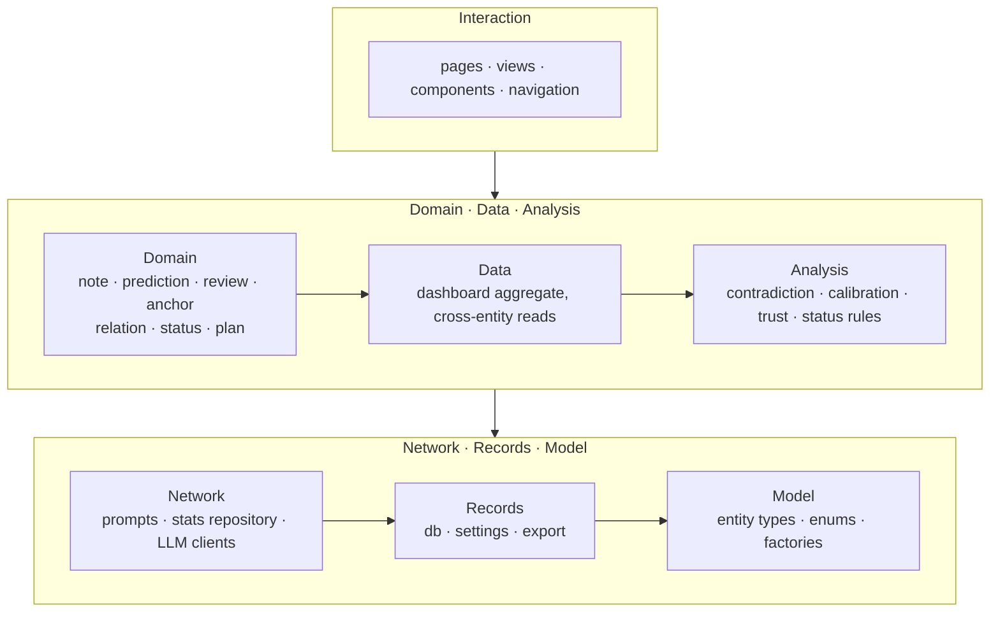
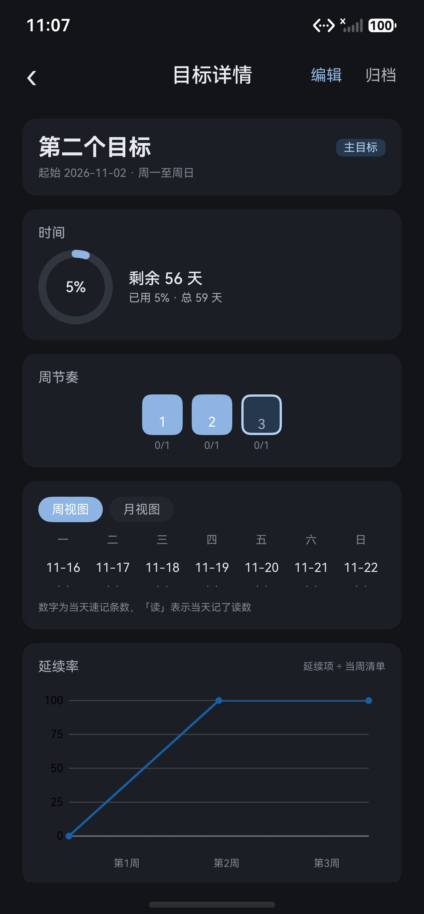
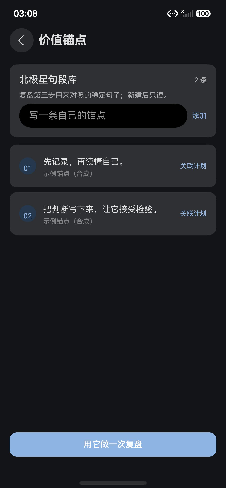

<h1 align="center">cogit-lucid-workbench</h1>

<p align="center">A local-first HarmonyOS workbench that turns the metacognition loop — record, review, calibrate, check against anchors — into a daily habit.</p>

<p align="center">
  <a href="./README.md">English</a> | <a href="./README.zh-CN.md">简体中文</a>
</p>

<p align="center">
  <a href="./LICENSE"></a>
  
  
  
</p>

## Overview

`cogit-lucid-workbench` joins cogit and lucid. cogit is the Latin cogito (I think), the word at the centre of Descartes's "Cogito, ergo sum" (I think, therefore I am) in *Meditations on First Philosophy*; lucid means clear and luminous. Put together, they read as making thinking clear.

The project began as an attempt to turn two lines of thought into a daily habit: metacognition and existentialism. Metacognition is thinking about thinking — noticing how you judge, then adjusting how you judge. Existentialism asks a different question: people have no pre-given nature and define themselves through freedom and choice, and handing that choice to circumstance, custom, or "this is just who I am" is what Sartre called bad faith. Metacognition supplies the method of recording and review; existentialism explains why the exercise is worth doing.

In the app, the two lines map onto recording and review. Notes, predictions and decisions freeze the judgment, confidence, reason and settlement date at the moment of writing; when the date arrives the judgment is checked, and the weekly review tests the explanation against the value anchors. What was judged then, and what changed later, both stay in the record.

cogit-lucid-workbench is a single-module HarmonyOS application. The in-app title is **Cogit Lucid**, the launcher keeps the repository name, and the Chinese name is still undecided. It keeps what you noticed, decided and predicted, plus how you reviewed it, in a local database, and carries those records into the next round; it suits people who already review their weeks and want earlier judgments to stay checkable.

Three choices set it apart from a journal:

- **A prediction freezes on save.** Confidence, reason, and settlement date are written once. Settling later only adds the outcome; a later edit appends a version instead of overwriting the call that was made.
- **The model stays opt-in.** Records sit in the on-device database. The review agent reads them only after you switch to mock or model mode, and the API key is kept in the system asset store.
- **An anchor becomes read-only once written.** You can keep adding sentences, but a stored one cannot be edited or removed, and it is what the contradiction step checks against.

The interface is Chinese only. The in-app name lives in `entry/src/main/ets/theme/AppIdentity.ts`, the launcher label in `AppScope/resources/base/element/string.json`.

The home page opens with the identity band (avatar, nickname, signature, custom title) and four counters: notes today, pending settlements, consecutive record days, and the latest review. Readings, the weekly card, the plan card, and the six-module grid follow. The `数据看板` button under the counters opens the analytics page.

## Project status

The build covers six record modules — notes, predictions and settlement, four-step reviews with an optional agent, relations, anchors, and status readings — plus plans that organise them: a goal, optional projects, seven-day nodes, and a checklist. The goal page adds a deadline ring, a one-square-per-week rhythm strip, week and month views, a carry-over line, and a split of linked records by module. Settings carry page backgrounds and surface opacity, Markdown export writes the whole record set, backup and restore hand a `.cogitbackup` file to the system save dialog, and the analytics dashboard renders a remote sample payload with twelve months of detail.

Records live in an encrypted `relationalStore` database (twelve tables). If the store cannot be opened on a device, the home page shows a blocking view with retry and exit instead of writing plaintext; only runs without `relationalStore` — the DevEco Previewer reports code 801 — fall back to the in-memory demo data, and the counters are labelled as demo content.

The app is one module, targets `targetSdkVersion` 26.0.0 with a minimum of 6.1.1 (API 24), declares `phone` as the only device type, and ships a light and a dark palette that follow the system colour mode. The device suite has seven cases; the local check scripts cover the pure functions and services, and both are described under Tests. Known limits: the interface is Chinese only, the analytics page reads the remote sample file rather than local records, and model modes need your own endpoint and key.

## Highlights

| Highlight | What it gives you |
|---|---|
| Frozen prediction log | Target, judgment, confidence 0-100, reason, and a settlement date written once; settlement fills the outcome and marks hit or miss. |
| Hit-rate statistics | Overall rate, a six-month monthly trend, and a hit/miss donut, drawn with `@ohos/mpchart`. |
| Analytics dashboard | Ten charts over one remote payload: calibration curve, monthly hit rate, outcome split, confidence distribution, horizon buckets, sleep trend, sleep-vs-hit rate, interaction counts, coverage heatmap, and activity heatmap. A month picker selects one of twelve months, and every chart reads that month's detail. The page renders the remote sample and does not read local records. |
| Encrypted local store | All twelve tables live in an encrypted `relationalStore` database. If the store cannot be opened, the home page shows a blocking view with retry and exit instead of writing plaintext. |
| Previewer demo mode | Only where `relationalStore` is missing — the DevEco Previewer reports code 801 — the home page reads the in-memory preview store and labels the counters as demo data. |
| Four-step review | Facts, interpretation, contradiction, action. The contradiction step ticks value anchors and uses them to test the explanation. |
| Plan ladder | A goal, an optional project group, seven-day nodes, and a checklist. Only one goal is primary; closing a node carries unfinished items into the next week and writes a review draft. The goal page adds a deadline ring, a one-square-per-week rhythm strip, week and month views, a carry-over rate line, and a link split by module. |
| Two-way record links | A plan node picks records from any of the six modules, and every record detail page can attach itself to a plan node. |
| Three-tier trust | Each relation carries a friendly, sincere, or transparent tier and renders as a star graph centred on you. |
| Threshold readings | Sleep below 6.5 hours, zero exercise, or one late-night alert raises a flag on the status panel. |
| Markdown export | Eight record groups render into one Markdown file, written to the sandbox first and then handed to the system save dialog; plan links to sealed records print a placeholder instead of their titles. |
| Backup and restore | A database snapshot, identity, settings and background pictures travel in one `.cogitbackup`; the current database is copied aside before a restore, and the API key never enters the bundle. |
| Home identity band | Avatar, nickname, signature, and a hand-written title sit above four counters: notes today, pending settlements, record streak, and the latest review. |
| Backgrounds and page opacity | One default picture or one per module, from the gallery, the camera, or the file picker. Picture strength runs 4-30% and the page surface itself takes 0-60% transparency, so the setting works with or without a picture. |

## Architecture

The dependency direction runs one way: from interaction at the top down to the model layer at the bottom. A layer only calls the layers below it; `analysis/` imports nothing but `model/` types, so rules stay testable without a database or a UI. `app/` holds cross-page buses for refresh events and the database health state.



- ArkTS pages with state management V2 (`@ComponentV2`, `@Local`, `@Param`); entity models and services in plain TypeScript.
- Navigation with `NavPathStack`; 32 route names live in `entry/src/main/ets/navigation/Routes.ts`, and a new page only adds a branch to `Index.pageMap`. The tree holds 34 page files and 33 reusable components.
- `relationalStore` is the single source of truth and is encrypted; `Preferences` keeps non-secret options, the model key sits in the system asset service, and `fileIo` writes the Markdown export.
- `@ohos/mpchart` 3.1.0-rc.0 is the only runtime dependency. Icons come from system glyphs rather than an icon pack.
- `components/charts/` wraps mpchart for lines, bars, and pies, and draws the heatmaps on Canvas. `network/RemoteStatsRepository` reads the analytics JSON from Gitee first, then GitHub.
- `preview/` supplies in-memory demo data so pages render in the DevEco Previewer; no page reads it while the database is available.
- `profile/` handles the home identity: nickname, signature and title are three text fields stored through Preferences alongside the avatar path, while the avatar image runs a separate 320 px square pipeline.

## Usage Example

The home page opens with the identity band and four counters; today's readings, a weekly settlement or onboarding card, the plan card, and the grid of six modules follow below. `编辑` and `设置` sit on the right of the identity band.


### Set your identity

1. Tap `编辑` on the identity band.
2. Pick an avatar from the gallery, the camera, or the file picker; the picture is centre-cropped to a 320 px square and stored in the app sandbox.
3. Fill in a nickname (up to 12 characters), a signature (24), and a title (8).
4. Tap `保存`. The band updates at once and keeps the values after a restart.

Expected result: the header shows the new avatar and text; an empty nickname or title falls back to `记录者` and `未命名`.

### Keep one prediction

1. Open the prediction module (`预测`). Pending settlements are listed by due date first; settled ones by creation time.
2. Tap `+`. Fill in the target, the judgment, a confidence between 0 and 100, the reason, and the settlement date.
3. Save. The record is append-only from here — a later edit adds a version instead of overwriting the original.
4. On the due date, open the detail page, record the actual outcome, and mark it hit or miss.
5. Open prediction statistics (`预测统计`) for the overall rate, the trend, and the split.

Expected result: after two or three settled predictions the statistics page draws a trend line and a donut around the rate. With nothing settled yet, the rate shows a dash rather than 0 percent, and the sample count is stated next to it.

### Open the analytics dashboard

1. On the home page, tap `数据看板` under the four counters.
2. The page requests `stats-12m.json` from `docs/mock/` in the public repository and draws ten charts: monthly hit rate, calibration curve, outcome split, confidence distribution, horizon buckets, sleep trend, sleep-vs-hit rate, interaction counts, coverage heatmap, and activity heatmap. It does not read local records.
3. Pick a month chip; the header and every chart switch to that month's detail. Tap `刷新` to request the payload again.
4. If both the Gitee and GitHub requests fail, the page keeps the error message and a retry action.

Expected result: the header states the remote data timestamp and the selected month. The calibration line sits against a 45-degree reference; choosing another month changes calibration, outcomes, readings and both heatmaps; the two heatmaps label weekdays and columns.

### Run one review

1. Open the review module (`复盘`) and pick the week or month tab. Each tab keeps its own draft.
2. Work through the four steps: facts, interpretation, contradiction, action. Facts and action are required.
3. In the contradiction step, tick the value anchors that apply and check the explanation against them.
4. Optionally open the agent panel to generate contradiction candidates. Template mode is offline; mock and model modes call an endpoint.
5. Save. The period shows as complete and the session is kept in review history.

### Plan one week

1. The plan card sits under the weekly settlement card. With no goal, tap `新建`; afterwards `查看 ›` opens the current goal.
2. Give the goal a title and a start date; the start date snaps to the Monday of that week. The end date is optional: leave it empty to track weeks only, or set a date later than that Monday to get a countdown.
3. Open this week's node and add checklist items; tap an item to mark it done. The node header shows how many days are left and a three-part bar for done, carried over, and new items.
4. Optionally create a project inside the goal and assign the node to it. A project can be renamed or deleted; deleting it returns its nodes to ungrouped and keeps every item.
5. Tap `结束本周`. Unfinished items carry into the next week, and a review draft is prefilled for the closed node. `去复盘` opens the review with the node context; the review page keeps a `返回节点` action.
6. Tap `关联记录` to pick records from the six modules. The picker marks records from the same week, ranks them by shared relation and tag, and offers keyword search plus a `加载更多` action.

Expected result: only one goal carries the `主目标` badge. The goal page shows a deadline ring when an end date is set, otherwise `已推进 N 周`; a one-square-per-week rhythm strip; week and month views; a carry-over line once three weeks have checklists; and a split of linked records by module.

### Set a page background

1. Open settings (`设置`) and tap `打开页面背景`.
2. Pick a source: `从相册选择`, `拍一张`, or `选择文件`. The picture is converted to PNG and capped at 1080×1920.
3. Back on the apply page, set it as the default for `全部页面（默认）`, or tick pages and tap `应用`.
4. Adjust `背景浓淡` (4–30%) so the picture stays readable behind the cards, and `页面透明度` (0–60%) for the surface itself. Both apply to every page or only to the ticked ones.

Expected result: the module you open shows the picture behind its cards. Transparency at 0% keeps the surface solid; raising it lets the system wallpaper show through, whether or not a picture is set.

### Take the records out

Settings (`设置`) writes the whole record set to `cogit-export-YYYYMMDD-HHMM.md`, then opens the system save dialog so it can be copied to a folder you pick; cancel that dialog and the file stays in the sandbox, with the name, character count and record count still shown, and `分享` can send it out later. Sealed records are left out, a plan link to a sealed record prints `已封存记录`, and a plan with an end date adds one `结束：` line.

## Screens

Captured on a Mate 70 Pro emulator from the current build, in dark mode. Every record in them is synthetic.

| Home | Analytics, current month |
|---|---|
|  |  |
| **Analytics, mid-page** | **Analytics, lower section** |
|  |  |
| **Goal detail** | **Review detail** |
|  |  |
| **Anchors** | **Relation graph** |
|  |  |
| **Settings, model mode** | **Markdown export** |
|  |  |

## Quick Install

### Requirements

- DevEco Studio with the HarmonyOS SDK that contains API 26 (`targetSdkVersion` 26.0.0); the app runs from 6.1.1 (API 24) upward.
- A HarmonyOS phone emulator or a phone. `deviceTypes` declares `phone` only.
- Node.js only if you want the local mock server. The hvigor command below uses the Node.js bundled with DevEco Studio.

### Get the code

```bash
git clone git@github.com:SunshineMahiru/cogit-lucid-workbench.git
cd cogit-lucid-workbench
```

A mirror is served from `git@gitee.com:theangelnextdoor/cogit-lucid-workbench.git`.

### Install dependencies

Open the project in DevEco Studio and let Sync finish. The runtime dependency is `@ohos/mpchart` 3.1.0-rc.0; `@ohos/hypium` and `@ohos/hamock` are dev-only for tests. All three are declared in `oh-package.json5`.

A command line build is possible from the project root:

```bash
node "<DevEco Studio>/tools/hvigor/bin/hvigorw.js" assembleHap --mode module -p product=default --no-daemon
```

Point `DEVECO_SDK_HOME`, `NODE_HOME`, and `JAVA_HOME` at the DevEco toolchain first. Artifacts land in `entry/build/default/outputs/default/`. The tracked profile has no signing config, so a build without a local signing file produces `entry-default-unsigned.hap`.

## Quick Start

1. Open the project in DevEco Studio and wait for Sync to finish.
2. Start a phone emulator or connect a phone.
3. Select the `entry` module and run. DevEco signs with the debug certificate when automatic signing is on; otherwise add `signing/signing.local.json` first (see Signing).
4. Tap `＋ 速记` in the bottom right, write one line, and save. The `速记` tile in the module grid opens the same editor; it just sits below the fold.
5. The note appears under recent notes, and the counters move off zero.
6. Tap `数据看板`, then pick a month chip, to confirm the remote payload loads and the charts switch to that month.

Expected result: one note today and one in total, the weekly settlement card starts counting it, and the analytics page shows a remote timestamp with ten charts. If the request fails, the page keeps the error message and a retry action.

The DevEco Previewer can render the pages, but it has no `relationalStore`; record pages show demo content and empty counters there. Use an emulator or a phone to see real data.

## Configuration

### Mock server and endpoint routing

The review prompt panel and the local mock completion mode both talk to the zero-dependency Node server in `mock-server/`.

```bash
node mock-server/server.js
```

It listens on `0.0.0.0:4523`. Change the port through the environment: `PORT=8080 node mock-server/server.js`.

| Method | Path | Response |
|---|---|---|
| GET | `/health` | `{ "status": "ok" }` |
| GET | `/review-prompts?period=week` | `{ "prompts": [...] }`; `period=month` returns monthly prompts |
| POST | `/llm/complete` | Mock completion used by the local mock mode |
| POST | `/v1/chat/completions` | OpenAI-compatible; the app reads `choices[0].message.content` |

Request URLs come from three places:

- Review prompts: read the base URL in settings, drop a trailing `/v1`, and the rest is the mock root. With untouched settings that is `http://localhost:4523`.
- Local mock: always `http://localhost:4523/llm/complete`, fixed in `network/ApiConfig.ts`. Settings do not affect this mode.
- Model mode: the base URL is used as it stands, and the client appends `/chat/completions`.

| Environment | Reaches `localhost:4523` | What to do |
|---|---|---|
| DevEco Previewer | Yes | The default URL works |
| Emulator | No, `127.0.0.1` is the emulator itself | `hdc rport tcp:4523 tcp:4523`, which carries both prompts and local mock; pointing the base URL at the host works too |
| Phone | No | Prompts follow the host address in settings and fall back to three local ones when none is set; the local mock address is fixed and cannot work here, so use model mode for testing |

Worth knowing:

- Cleartext HTTP is off by default. `entry/src/main/resources/base/profile/network_config.json` allows `127.0.0.1` and `localhost` only. A phone reaching the mock server over HTTP needs its host address added there; keep that line out of commits.
- Timeouts differ per call: 5 seconds for prompts, 8 for the local mock completion, 20 for model mode.
- `hdc rport` lasts for the current connection; run it again after an emulator restart.

### Remote analytics data

The dashboard does not read the local database. Its charts have one source: the static JSON in `docs/mock/` of the public repository. No key is involved, and the page labels the payload as example data.

| File | Content |
|---|---|
| `stats-12m.json` | Twelve monthly points, plus one detail block per month: calibration, outcomes, confidence, horizon, readings, coverage, sleep buckets, interactions, and activity cells |

Base URLs:

- Gitee: `https://gitee.com/theangelnextdoor/cogit-lucid-workbench/raw/main/docs/mock/`
- GitHub: `https://raw.githubusercontent.com/SunshineMahiru/cogit-lucid-workbench/main/docs/mock/`

`RemoteStatsRepository` tries Gitee first and GitHub second, adding a cache-busting `t` parameter. If both fail, the page keeps the error text and a retry action. Switching months filters the monthly detail already loaded; it does not issue a new request.

### Backgrounds and page opacity

| Item | Detail |
|---|---|
| Entry point | Settings → `页面背景` → `打开页面背景` |
| Sources | Gallery, camera, or the document picker limited to picture suffixes. Every source is converted to PNG and capped at 1080×1920 |
| Scope | Pick a picture, then tick the target pages: one module alone, or several at once. Pages without a picture of their own use the default one, and clearing a module returns it to that default |
| Strength | 4%-30%, default 10%. A higher value makes the picture more visible and the body text less comfortable to read |
| Opacity | 0%-60%, default 0%. With pages ticked the change applies to those modules; with nothing ticked it changes the global value |
| Storage | `${filesDir}/page-backgrounds`, named by content hash so an identical picture is stored once; files no page points at are removed at startup |
| Dark mode | Strength is multiplied by 0.7 and a black scrim is added, so the picture does not glow against a dark surface |

Opacity needs no picture: it lowers the alpha of the page surface itself. The window is created with a clear background colour, so a transparent page reveals what sits behind the window. After a module has its own value, `恢复跟随` hands it back to the global one.

### Home identity

| Item | Detail |
|---|---|
| Entry | `编辑` on the identity band |
| Fields | Nickname up to 12 characters, signature 24, title 8; an empty nickname or title falls back to `记录者` / `未命名` |
| Avatar | Gallery, camera, or the file picker; centre-cropped to a 320×320 PNG in `${filesDir}/profile`; replacing it deletes the previous file |
| Storage | Preferences store `cogit_profile`; none of the fields is secret |
| Refresh | Settings → `数据管理` → `刷新首页数据` re-reads the four counters |

### Review agent modes

| Mode | What it calls | Notes |
|---|---|---|
| Template | Nothing | Default. Works offline |
| Local mock | `http://localhost:4523/llm/complete` | No key required. The address is fixed, so this mode cannot reach a host from a phone; use model mode there |
| Model | `{base URL}/chat/completions` | Needs a base URL, a model name, and an API key |

Defaults: base URL `http://localhost:4523/v1`, monthly budget 30 yuan, capped at 500. The model picker offers `GLM-4.7-Flash` and `DeepSeek V4-Flash`, the former by default.

The API key goes into the system asset store, and the Preferences entry stays empty. If the asset store cannot be written, saving fails instead of falling back to plaintext. The key never enters an export.

Budget 0 leaves template mode as the only option: local mock and model mode both skip the request and fall back. Cost is estimated from character counts and recorded in a monthly ledger. An exhausted budget or a failed request falls back the same way.

### Security levels

| Level | Default for new records | Enters LLM context | Enters export |
|---|---|---|---|
| `analyzable` | No | Yes, once a model mode is on | Yes |
| `local_only` | Yes | No | Yes |
| `sealed` | No | No | No |

A level is chosen per record. The default in settings applies to records created after the change; it does not rewrite what already exists.

### Signing

The tracked `build-profile.json5` keeps `signingConfigs` empty on purpose. At build time, `hvigorfile.ts` looks for `signing/signing.local.json` and injects the `default` signing config when the file is there. That file, along with `*.p12`, `*.cer`, and `*.p7b`, sits in the ignore list, so a fresh clone builds an unsigned HAP.

To sign locally:

1. Copy `docs/signing.local.example.json` to `signing/signing.local.json`.
2. Fill in the certificate, profile, and keystore paths, plus the DevEco-encrypted `keyPassword` / `storePassword` values. Those two are ciphertext in the documented format; keep them that way unless the local hvigor version happens to accept plaintext.
3. Build again and check for `entry-default-signed.hap` under `entry/build/default/outputs/default/`.

### Export

Settings writes one Markdown file covering events, decisions, relations, predictions, anchors, status readings, review results, and plans, named like `cogit-export-20261027-0845.md`. `导出并另存为` opens the system save dialog and copies the file to the folder you pick; cancel it and the file stays in `${filesDir}/exports`, where `分享` can still send it out; only the ten newest exports are kept, and older ones are removed on the next export.

Sealed records are dropped. A plan link that points at a sealed record prints `已封存记录` in place of a title. A plan with an end date gets an extra `结束：` line.

### Backup and restore

| Item | Detail |
|---|---|
| Entry | Settings → `数据管理` → `备份并另存` / `恢复备份` |
| What a backup is | A `cogit-backup-<timestamp>.cogitbackup` file: JSON carrying a database snapshot, the identity and avatar, settings, and every page background with its opacity |
| Saving it | A system save dialog opens straight away; pick a folder. Cancel it and the app reports `已生成备份，但未另存` |
| Restore order | Version and database are validated, the current database is copied to `pre-restore-*.db`, then database, identity, settings and backgrounds come back, and the home page refreshes |
| Left out | The API key. The field is emptied before packing and the restore writes non-secret options only, so enter it again on the new phone |

The same card holds `清空全部数据`: the first tap turns it into `确认清空`, and the second one deletes. It wipes every row in the twelve tables, settings, identity, background pictures, the exported and backup files inside the sandbox, and the API key; files already saved elsewhere on the phone are left alone.

## Project Layout

```text
cogit-lucid-workbench/
├── AppScope/                       bundle name, version, launcher icon
├── entry/                          the only module
│   ├── src/main/
│   │   ├── ets/
│   │   │   ├── entryability/       app entry, opens the database
│   │   │   ├── pages/              34 page files; Index.ets holds the route table
│   │   │   ├── views/              composed home views
│   │   │   ├── components/         40 reusable pieces
│   │   │   │   └── charts/         line, bar, pie wrappers, Canvas heatmap
│   │   │   ├── navigation/         route names and parameter types
│   │   │   ├── model/              entity types, enums, factories, demo data
│   │   │   ├── data/               home aggregation and cross-entity reads
│   │   │   ├── app/                database health, home and identity refresh buses
│   │   │   ├── preview/            demo data for the previewer
│   │   │   ├── profile/            identity store and avatar pipeline
│   │   │   ├── note/               quick notes, templates, drafts, checks
│   │   │   ├── prediction/         predictions and settlement
│   │   │   ├── review/             review flow and the agent
│   │   │   ├── anchor/             value anchors
│   │   │   ├── relation/           people and relations
│   │   │   ├── status/             status readings
│   │   │   ├── plan/               goals, week nodes, chart inputs
│   │   │   ├── analysis/           rules, analyzers, date and metric helpers, LLM adapters
│   │   │   ├── db/                 12 table statements, 8 DAOs, tolerant JSON
│   │   │   ├── settings/           options, backgrounds, asset-store key, budget ledger
│   │   │   ├── export/             Markdown sections and the file writer
│   │   │   ├── network/            prompt and stats repositories, HTTP, LLM clients
│   │   │   └── theme/              font, radius and spacing scales, system colour mapping
│   │   └── resources/              base and dark resource sets, network config
│   ├── src/test/                   Hypium unit tests
│   └── src/ohosTest/               device tests, including the analytics UiTest flow
├── mock-server/                    zero-dependency Node mock server
├── hvigor/                         builder config
├── signing/                        local signing config and material (ignored)
├── docs/                           project notes, UI freeze record, screenshots, dashboard JSON, signing template
├── build-profile.json5             SDK versions, product, build modes
├── hvigorfile.ts                   build script that injects local signing
├── oh-package.json5                dependencies
├── code-linter.json5               static check rules
└── LICENSE                         AGPL-3.0
```

A new page touches three places: add the name in `navigation/Routes.ts`, drop the page file into `pages/`, and wire it into `pageMap` in `pages/Index.ets`.

## Tests

Cases live in three places: `entry/src/test` holds local unit tests that run on the computer, `entry/src/ohosTest` holds a device suite that needs an emulator or a phone, and `.test/` holds plain Node scripts that compile the TypeScript sources and exercise the domain layer without any HarmonyOS runtime.

| Suite | File | Cases | Covers |
|---|---|---|---|
| Local unit | `src/test/List.test.ets` | 4 | Two prediction form checks, confidence calibration bands, the export level filter |
| Device · analysis | `src/ohosTest/ets/test/Analysis.test.ets` | 4 | The same four as above, run again on the device |
| Device · flow | `src/ohosTest/ets/test/UiFlow.test.ets` | 6 | Open the dashboard, switch month, return home, open settings, switch to the model provider, switch back |
| Node scripts | `.test/check.js` and four siblings | 127 | Date and metric helpers, services, export, review agent fallbacks, plan factories |

Local unit tests:

```bash
node "<DevEco Studio>/tools/hvigor/bin/hvigorw.js" test -p module=entry --no-daemon
```

The Node scripts compile the TypeScript sources into `.test/out2` first, then run each file; they need no emulator and no `ohpm` install:

```bash
tsc -p .test/tscheck/tsconfig.emit.json
node .test/check.js
node .test/service-check.js
node .test/export-check.js
node .test/agent-check.js
node .test/plan-check.js
```

The device suite needs both HAPs installed before `aa test` can take over:

```bash
node "<DevEco Studio>/tools/hvigor/bin/hvigorw.js" assembleHap --mode module -p module=entry@ohosTest -p product=default --no-daemon
hdc install -r entry/build/default/outputs/default/entry-default-signed.hap
hdc install -r entry/build/default/outputs/ohosTest/entry-ohosTest-signed.hap
hdc shell aa test -b com.sunshinemahiru.cogitlucid -m entry_test -s unittest OpenHarmonyTestRunner -w 10000
```

Expected output: `Tests run: 10, Failure: 0, Error: 0, Pass: 10`.

Two things that trip people up: `hvigorw test` runs on Windows and macOS only, not on Linux; and `aa test` defaults to a 5 second timeout, which the flow cases outrun, so `-w 10000` raises it to ten.

## Documentation

| Topic | What it covers | Link |
|---|---|---|
| Startup baseline | Method and numbers for cold and warm launch on the emulator | [docs/PERF_BASELINE.md](./docs/PERF_BASELINE.md) |
| Visual tokens | Locked colour, type, radius, and spacing tokens, plus the per-page checklist and known deviations | [docs/UI_FREEZE.md](./docs/UI_FREEZE.md) |
| Mock server | Endpoints, addressing, and the previewer versus emulator note | [mock-server/README.md](./mock-server/README.md) |
| Signing template | Placeholder config for `signing/signing.local.json` | [docs/signing.local.example.json](./docs/signing.local.example.json) |

## FAQ

**Where do records live, and do they leave the device?**
All twelve tables sit in the local `relationalStore`, encrypted as a whole with a key the system manages. Template mode never touches the network. Once model mode is on, only `analyzable` text reaches the base URL you entered. `sealed` records enter neither the model context nor an export.

**How do I move records to a new phone?**
Settings → `数据管理` → `备份并另存` produces a `.cogitbackup` file carrying a database snapshot, the identity, settings, and background pictures. Install the app on the new phone and pick `恢复备份`; a `pre-restore-*.db` copy is kept before anything is overwritten. The API key does not travel with the backup, so enter it again.

**Where does the exported Markdown go?**
`导出并另存为` opens the system save dialog, and the file lands in whatever folder you pick. Cancel the dialog and it stays in `${filesDir}/exports`, where `分享` can still send it out; the folder keeps the ten newest exports.

**The previewer shows an empty home page or a database error.**
The DevEco previewer does not provide `relationalStore`. When the store cannot be opened, the home page reads the in-memory preview data and marks the counters as demo values; other data-backed pages have their own fallbacks. Use an emulator or a phone to see real records.

**The dashboard shows example data.**
It reads `docs/mock/stats-12m.json` from the public repository, Gitee first and GitHub second, and the header labels the payload as example data. Edit that file to change what the charts show.

**The emulator cannot reach the mock server.**
`127.0.0.1` inside the emulator is the emulator itself. Run `hdc rport tcp:4523 tcp:4523` to forward the port; on a phone, put the host address into the base URL in settings instead.

**The built HAP will not install.**
Without a local signing file, `assembleHap` produces `entry-default-unsigned.hap`, which the device refuses. Create `signing/signing.local.json` from `docs/signing.local.example.json`, or configure signing in DevEco Studio, then rebuild. The tracked `build-profile.json5` carries no signing config on purpose.

**The launcher name and the in-app title disagree.**
The launcher label `cogit-lucid-workbench` comes from `AppScope/resources/base/element/string.json`; the in-app title `Cogit Lucid` comes from `theme/AppIdentity.ts`. The Chinese name is not settled, so both are placeholders.

**The camera option fails right away.**
The system camera picker needs a camera application on the device. Emulators usually ship without one, so use the gallery or the file picker there.

**A transparent page shows the wallpaper underneath.**
The window is created with a clear background colour, so lowering page opacity reveals whatever sits behind the window. Nothing is read from another application.

**Is dark mode supported?**
Yes. `theme/AppTheme.ts` carries a light and a dark palette; the app reads the system mode at launch and re-applies it when the system setting changes. Background pictures are dimmed and covered with a black scrim in dark mode.

**Why only one runtime dependency?**
Charts are drawn on native canvas through `@ohos/mpchart`. No web view and no third-party icon pack, which keeps the HAP small and avoids asset licensing.

## Contributing

For anything beyond a small fix, open an issue first so the direction is agreed before the work happens. Small patches can go straight to a pull request.

- Commit messages follow Conventional Commits: an English subject in `type(scope): subject` form with a body explaining the reason.
- One logical change per commit. A larger feature is split into steps that can each be verified on their own.
- Comments are in English; interface copy is in Chinese, matching the existing pages.
- No third-party UI kit — components live in `components/` and are written here.
- A new page touches three places: the name in `navigation/Routes.ts`, the file in `pages/`, and `pageMap` in `pages/Index.ets`.
- Do not commit real records, screenshots showing a real name or avatar, or `.cogitbackup` files. Demo content belongs in the sample data under `model/`.
- Signing material, HAPs and logs stay out of commits; `.gitignore` already covers them.
- Before a pull request, run the rules in `code-linter.json5`, run `assembleHap`, run both suites from the Tests section, and say in the pull request how you verified the change.

`main` is the only development branch and Gitee is a mirror. Send pull requests to GitHub; the maintainer syncs them across after merging.

## License

Released under the [GNU Affero General Public License v3.0](./LICENSE).

AGPL adds one obligation on top of GPL: if a modified version is offered to users over a network, its source has to be made available to them too. Running it locally does not trigger that.

Copyright (c) 2026 SunshineMahiru (曦昼Sunshine).

The only runtime dependency is `@ohos/mpchart`, licensed under Apache License 2.0, whose text ships with the package. `@ohos/hypium` and `@ohos/hamock` are test-only and stay in `devDependencies`.
