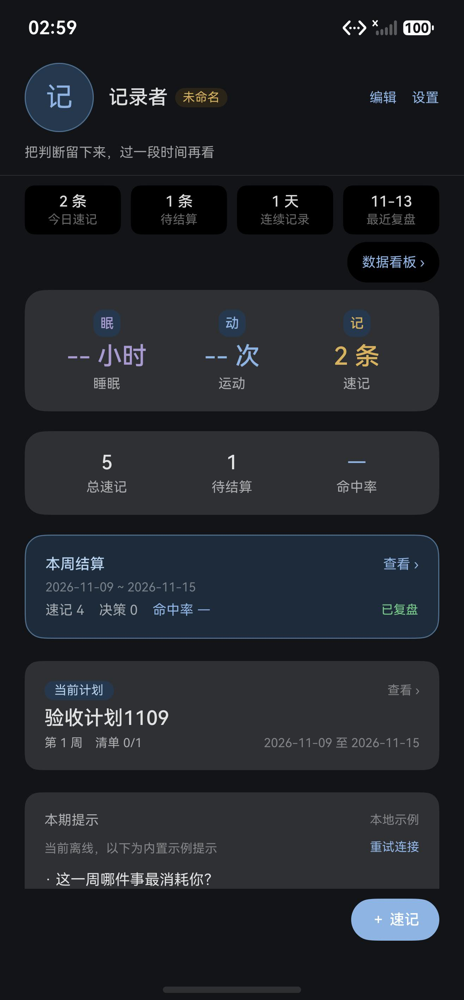
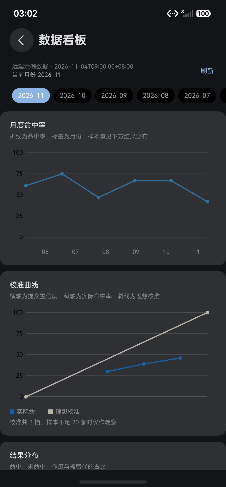
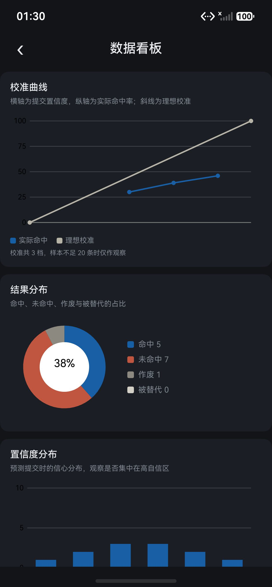
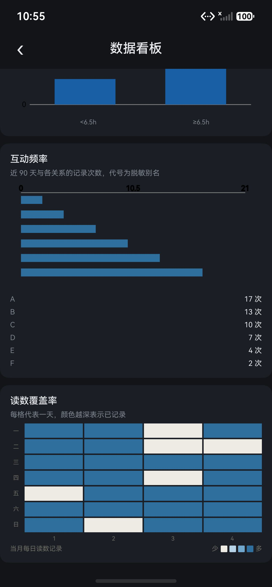
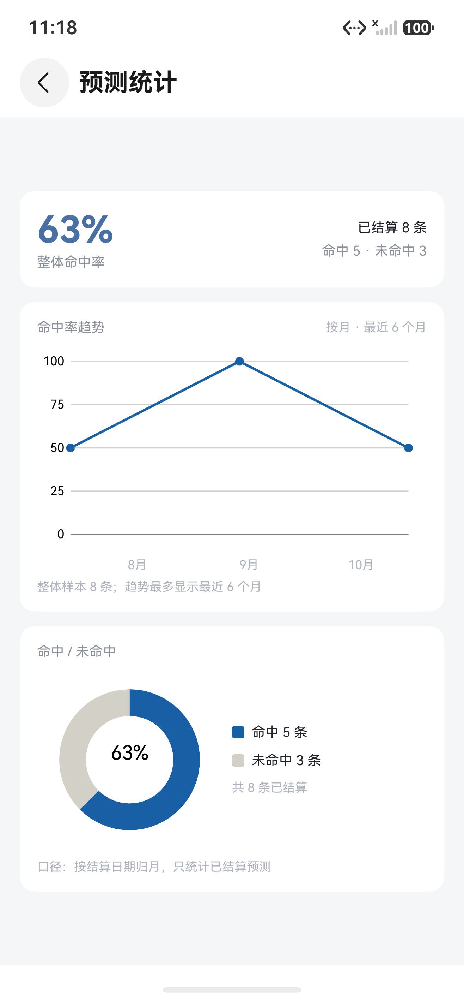
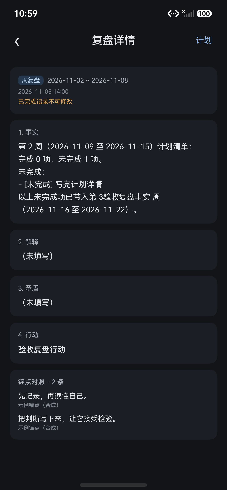
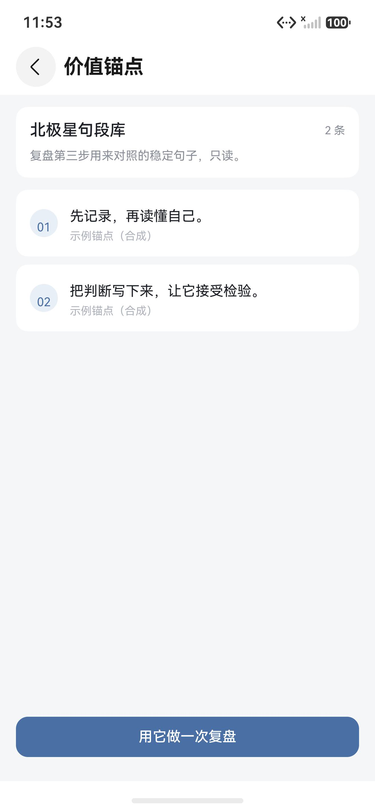
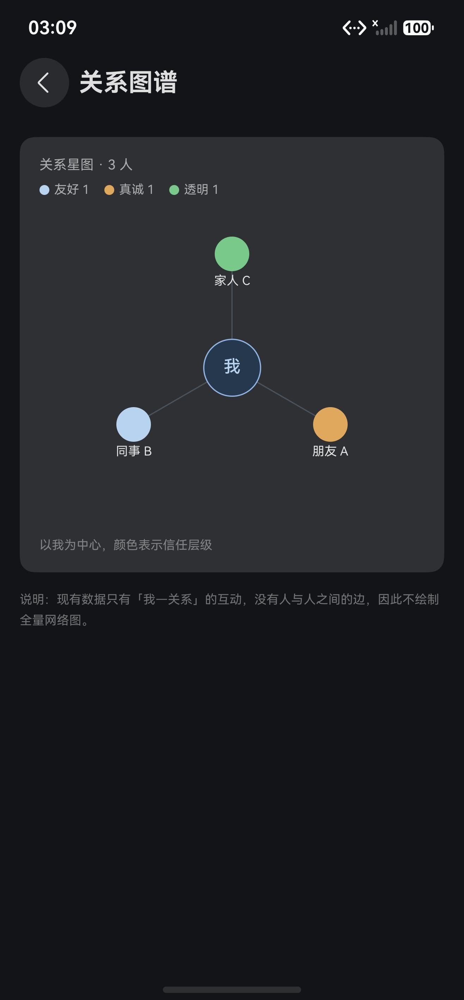
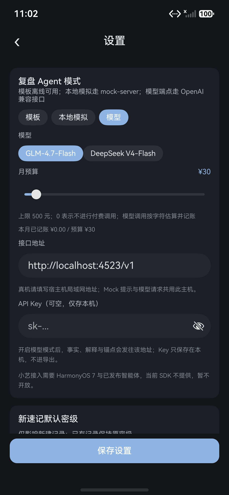
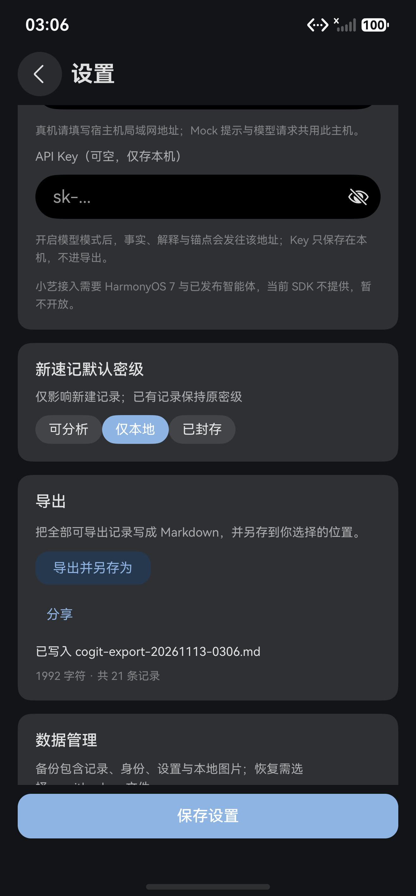

<h1 align="center">cogit-lucid-workbench</h1>

<p align="center">A local-first HarmonyOS workbench that turns the metacognition loop — record, review, calibrate, check against anchors — into a daily habit.</p>

<p align="center">
  <a href="./README.md">English</a> | <a href="./README.zh-CN.md">简体中文</a>
</p>

<p align="center">
  <a href="./LICENSE"></a>
  
  
  
</p>

## Overview

cogit-lucid-workbench is a single-module HarmonyOS application, labelled **Cogit Lucid** on the device. It keeps a private record of what you noticed, what you decided, what you predicted, and how you reviewed it, then feeds those records into the next round. It is aimed at people who already keep a review habit and want their judgments to stay checkable afterwards.

Three design choices separate it from a journal:

- **A prediction is frozen when saved.** Each one carries a confidence score, a reason, and a settlement date fixed in advance. You settle it against the outcome later, so the original call cannot be quietly edited into a hit. Revisions are stored as versions.
- **The model is opt-in.** Records live in the on-device database. The review agent reads them only when you switch to a model mode, and the API key stays on the device.
- **Anchors are read-only.** A small set of statements you chose to keep acts as the reference a contradiction is checked against, instead of advice invented at review time.

The interface is Chinese only. The display name is set in `entry/src/main/ets/theme/AppIdentity.ts` and the launcher label in `AppScope/resources/base/element/string.json`.

The launch screen opens with an identity band — avatar, nickname, signature, and a hand-written title — followed by four counters: notes today, pending settlements, consecutive record days, and the latest review date. Readings, the weekly card, the plan card, and the module grid sit below it. A `数据看板` button under the counters opens the analytics dashboard.

## Project status

The current build covers notes, predictions and settlement, review and the agent, relations, anchors, status, plans with weekly nodes, settings with page backgrounds and surface opacity, export, and a remote analytics dashboard. Both a light and a dark palette ship, and the interface follows the system colour mode. The home page is a normal destination on one navigation stack, so forward and back animate both pages. When `relationalStore` cannot be opened, as in the DevEco Previewer, the home page reads the in-memory preview store and labels the data as demo content. The project is still being refined.

## Highlights

| Highlight | What it gives you |
|---|---|
| Frozen prediction log | Target, judgment, confidence 0-100, reason, and a settlement date written once; settlement fills the outcome and marks hit or miss. |
| Hit-rate statistics | Overall rate, a monthly trend over the last six months, and a hit/miss donut, drawn with `@ohos/mpchart`. |
| Analytics dashboard | Ten charts over a remote JSON payload: calibration curve, monthly hit rate, outcome split, confidence distribution, horizon buckets, sleep trend, sleep-vs-hit rate, interaction counts, coverage heatmap, and activity heatmap. A month picker selects one of the twelve months; every chart reads that month's detail. The dashboard renders the remote example payload and does not read local records. |
| Preview fallback | In the DevEco Previewer, where `relationalStore` is unavailable, the home page falls back to the in-memory preview store and marks the counters as demo data. |
| Four-step review | Facts, interpretation, contradiction, action. The contradiction step can quote up to three anchors. |
| Plan ladder | A goal, an optional project group, seven-day nodes, and a checklist. Only one goal is primary; closing a node carries unfinished items into the next week and writes a review draft. |
| Two-way record links | A plan node picks records from any of the six modules, and every record detail page can attach itself to a plan node. |
| Three-tier trust | Each relation carries a friendly, sincere, or transparent tier and renders as a star graph centred on you. |
| Threshold readings | Sleep below 6.5 hours, zero exercise, or one late-night alert raises a flag on the status panel. |
| Markdown export | Eight record groups render into one Markdown file inside the app sandbox; plan links to sealed records print a placeholder instead of their titles. |
| Home identity band | Avatar, nickname, signature, and a hand-written title sit above four counters: notes today, pending settlements, record streak, and the latest review. |
| Backgrounds and page opacity | Set one default picture or one per module, taken from the gallery, the camera or the file picker. The page surface itself takes 0-60% transparency, so the setting works with or without a picture. |

## Architecture

The code is organised as six layers with a single dependency direction, plus a shared type layer at the bottom. A layer only calls the layers below it; `analysis/` imports nothing but `model/` types, so rules stay testable without a database or a UI. The `data/` layer owns cross-entity read models such as the dashboard aggregate.

```text
┌─────────────────────────────────────────────────────────────┐
│ interaction   pages/  views/  components/  navigation/      │
│               render and route dispatch                     │
├─────────────────────────────────────────────────────────────┤
│ domain        note/  prediction/  review/  anchor/          │
│               relation/  status/  plan/                     │
│               validation, composition, projection           │
├─────────────────────────────────────────────────────────────┤
│ data/         dashboard aggregate, cross-entity reads       │
├─────────────────────────────────────────────────────────────┤
│ analysis/     contradiction  calibration  anchors/trust     │
│               status rules   llm adapter                    │
│               imports model/ only                           │
├─────────────────────────────────────────────────────────────┤
│ network/      prompt + stats repositories  OpenAI-compatible│
│               local mock client  cleartext blocked          │
├─────────────────────────────────────────────────────────────┤
│ records       db/  settings/  export/                       │
│               relationalStore, Preferences, Markdown        │
├─────────────────────────────────────────────────────────────┤
│ model/        entity types, enums, factories                │
│               no imports outside model/                     │
└─────────────────────────────────────────────────────────────┘
```

- ArkTS pages with state management V2 (`@ComponentV2`, `@Local`, `@Param`); entity models and services in plain TypeScript.
- Navigation with `NavPathStack`; 32 route names are centralised in `entry/src/main/ets/navigation/Routes.ts`, and a new page only adds a branch to `Index.pageMap`.
- `relationalStore` is the single source of truth, `Preferences` holds non-secret options, the model key is stored in the system asset service, and `fileIo` writes the Markdown export.
- `@ohos/mpchart` 3.1.0-rc.0 is the only runtime dependency. Icons come from system glyphs rather than an icon pack.
- `components/charts/` wraps mpchart for lines, bars, and pies, and draws the two heatmaps on Canvas. `network/RemoteStatsRepository` reads the analytics JSON from Gitee first and GitHub second.
- `profile/` holds the home identity: a Preferences store for the four text fields plus a 320 px avatar pipeline.

## Usage Example

The home page opens with the identity band and four counters; today's readings, a weekly settlement or onboarding card, the plan card, and the grid of six modules follow below. `编辑` and `设置` sit on the right of the identity band.



### Set your identity

1. Tap `编辑` on the identity band.
2. Pick an avatar from the gallery, the camera, or the file picker; the picture is centre-cropped to a 320 px square and stored in the app sandbox.
3. Fill in a nickname (up to 12 characters), a signature (24), and a title (8).
4. Tap `保存`. The band updates at once and keeps the values after a restart.

Expected result: the header shows the new avatar and text; an empty nickname or title falls back to `记录者` and `未命名`.

### Keep one prediction

1. Open the prediction module (`预测`). Pending settlements are listed by due date first; settled ones by creation time.
2. Tap `+`. Fill in the target, the judgment, a confidence between 0 and 100, the reason, and the settlement date.
3. Save. The record is append-only from here — a later edit adds a version instead of overwriting the original.
4. On the due date, open the detail page, record the actual outcome, and mark it hit or miss.
5. Open prediction statistics (`预测统计`) for the overall rate, the trend, and the split.

Expected result: after two or three settled predictions the statistics page draws a trend line and a donut around the rate. With nothing settled yet, the rate shows a dash rather than 0 percent, and the sample count is stated next to it.

### Open the analytics dashboard

1. On the home page, tap `数据看板` under the four counters.
2. The page requests `stats-12m.json` from `docs/mock/` in the public repository and draws ten charts: monthly hit rate, calibration curve, outcome split, confidence distribution, horizon buckets, sleep trend, sleep-vs-hit rate, interaction counts, coverage heatmap, and activity heatmap. It does not read local records.
3. Pick a month chip; the header and every chart switch to that month's detail. Tap `刷新` to request the payload again.
4. If both the Gitee and GitHub requests fail, the page keeps the error message and a retry action.

Expected result: the header states the remote data timestamp and the selected month. The calibration line sits against a 45-degree reference; choosing another month changes calibration, outcomes, readings and both heatmaps; the two heatmaps label weekdays and columns.

### Run one review

1. Open the review module (`复盘`) and pick the week or month tab. Each tab keeps its own draft.
2. Work through the four steps: facts, interpretation, contradiction, action. Facts and action are required.
3. In the contradiction step, tick up to three anchors to check the explanation against.
4. Optionally open the agent panel to generate contradiction candidates. Template mode is offline; mock and model modes call an endpoint.
5. Save. The period shows as complete and the session is kept in review history.

### Plan one week

1. The plan card sits on the home page under the weekly settlement card. Tap `新建目标` when no goal exists; later taps open the current goal.
2. Give the goal a title and a start date. The start date snaps to the Monday of that week, because every node runs Monday to Sunday.
3. Open this week's node and add checklist items; tap an item to mark it done.
4. Optionally create a project inside the goal and give the node that project group. A project can be renamed or deleted; deleting it sends its nodes back to ungrouped and keeps every item.
5. Tap `结束本周`. Unfinished items carry into the next week, and a review draft is prefilled for the closed node. `去复盘` opens the review page with the node context, and the review page keeps a `返回节点` action.
6. Tap `关联记录` to pick records from any of the six modules. The picker marks records from the same week, ranks them by shared relation and tag, and offers a keyword search plus a `加载更多` action for older records.

Expected result: only one goal carries the `主目标` badge; the home card shows the current week with its done/total count; a closed node shows `已结束` and keeps its link into the review flow.

### Set a page background

1. Open settings (`设置`) and tap `更换页面背景`.
2. Pick a source: `从相册选择`, `拍一张`, or `选择文件`. The picture is converted to PNG and capped at 1080×1920.
3. On the apply page, either set it as the default for every page, or tick the modules that should carry it.
4. Adjust `页面透明度` for all pages, or only for the ticked module, then tap `完成`.

Expected result: the module you open shows the picture behind its cards. Transparency at 0% keeps the surface solid; raising it lets the system wallpaper show through, whether or not a picture is set.

### Take the records out

Settings (`设置`) writes the whole record set to `cogit-export-YYYYMMDD-HHMM.md` inside the app sandbox and reports the file name, character count, and record count. Sealed records are left out.

## Screens

Screenshots come from a Mate 70 Pro emulator. Every record in them is synthetic. The new home and dashboard captures use the current build in dark mode; the feature table below was captured earlier in light mode. Those feature pages keep their layout, while the home page now adds the identity band and the `数据看板` link.

| Home | Analytics, current month |
|---|---|
|  |  |
| **Analytics, mid-page** | **Analytics, heatmaps** |
|  |  |

The older feature captures follow; their page content still matches the current build apart from the identity band noted above.

| Prediction statistics | Review complete |
|---|---|
|  |  |
| **Anchors** | **Relation graph** |
|  |  |
| **Settings, model mode** | **Markdown export** |
|  |  |

## Quick Install

### Requirements

- DevEco Studio with the HarmonyOS SDK installed. The project targets `targetSdkVersion` 26.0.0 and is compatible with 6.1.1 (API 24).
- A HarmonyOS phone emulator or a phone. `deviceTypes` declares `phone` only.
- Node.js, only if you want the local mock server.

### Get the code

```bash
git clone git@github.com:SunshineMahiru/cogit-lucid-workbench.git
cd cogit-lucid-workbench
```

A mirror is served from `git@gitee.com:theangelnextdoor/cogit-lucid-workbench.git`.

### Install dependencies

Open the project in DevEco Studio and let Sync finish. The only runtime dependency is `@ohos/mpchart` 3.1.0-rc.0, declared in `oh-package.json5`.

A command line build is possible from the project root:

```bash
node "<DevEco Studio>/tools/hvigor/bin/hvigorw.js" assembleHap --mode module -p product=default --no-daemon
```

`DEVECO_SDK_HOME`, `NODE_HOME`, and `JAVA_HOME` need to point at the DevEco toolchain first. The tracked profile has no signing config; without a local signing file the output is an unsigned HAP.

## Quick Start

1. Open the project in DevEco Studio and wait for Sync to finish.
2. Start a phone emulator or connect a phone.
3. Select the `entry` module and run.
4. On the dashboard, open notes (`速记`), write one line, and save.
5. The note appears under recent notes, and the dashboard counters move off zero.
6. Tap `数据看板`, then pick a month chip, to confirm the remote payload loads and the charts switch to that month.

Expected result: the dashboard reports one note today and one in total, the weekly settlement card starts counting it, and the analytics page shows a remote timestamp with ten charts.

## Configuration

### Local mock server

The review prompt panel talks to a zero-dependency Node server in `mock-server/`.

```bash
node mock-server/server.js
```

It listens on `0.0.0.0:4523`; set `PORT` to change the port.

| Method | Path | Response |
|---|---|---|
| GET | `/health` | `{ "status": "ok" }` |
| GET | `/review-prompts?period=week` | `{ "prompts": [...] }` |
| GET | `/review-prompts?period=month` | `{ "prompts": [...] }` |
| POST | `/llm/complete` | Mock completion used by the local mock client |
| POST | `/v1/chat/completions` | OpenAI-compatible `choices[0].message.content` |

### Remote analytics data

The dashboard reads static JSON from `docs/mock/` in the public repository. No key is involved, and the page labels the payload as example data. It does not read the local database; these files are the only source for its charts.

| File | Content |
|---|---|
| `stats-12m.json` | Twelve months of monthly points, plus one detail block per month: calibration, outcomes, confidence, horizon, readings, coverage, sleep buckets, interactions, and activity cells |

Base URLs:

- Gitee: `https://gitee.com/theangelnextdoor/cogit-lucid-workbench/raw/main/docs/mock/`
- GitHub: `https://raw.githubusercontent.com/SunshineMahiru/cogit-lucid-workbench/main/docs/mock/`

`RemoteStatsRepository` requests `stats-12m.json` from Gitee first and GitHub second, adding a cache-busting `t` parameter. If both fail, the page shows the error and a retry action. Switching months filters the monthly detail already loaded; it does not issue a new request.

### Pointing the app at the server

- DevEco previewer: `http://127.0.0.1:4523` works as is.
- Emulator: `127.0.0.1` resolves to the emulator itself. Forward the port with `hdc rport tcp:4523 tcp:4523`, or point the model base URL in settings at the host address.
- Real device: localhost is not treated as a valid host. Set the model base URL to your host's address; otherwise the app shows local fallback prompts.
- Cleartext HTTP stays off by default; only `127.0.0.1` and `localhost` are allowlisted in `entry/src/main/resources/base/profile/network_config.json`. Add your own host there locally when a real device has to reach the mock server over HTTP, and keep that edit out of commits. The client timeout is 5 seconds.

### Backgrounds and page opacity

| Item | Detail |
|---|---|
| Entry point | Settings → `页面背景` → `更换页面背景` |
| Sources | Gallery, camera, or the document picker limited to picture suffixes. Every source is normalised to PNG and capped at 1080×1920 before it is stored. |
| Scope | One default picture covers every page without a picture of its own; a module that has its own picture overrides it, and clearing that picture returns the module to the default. |
| Ranges | Picture strength 4%-30% (default 10%); page transparency 0%-60% (default 0%). |
| Storage | `${filesDir}/page-backgrounds`, named by content hash so an identical picture is stored once; files no module points at are removed at startup. |
| Dark mode | Picture strength is multiplied by 0.7 and a black scrim is added, so the picture does not glow against a dark surface. |

The transparency slider needs no picture: it lowers the alpha of the page surface itself. The window is created with a clear background colour, so a transparent page reveals what sits behind the window.

### Home identity

| Item | Detail |
|---|---|
| Entry | `编辑` on the identity band |
| Fields | Nickname up to 12 characters, signature 24, title 8; an empty nickname or title falls back to `记录者` / `未命名` |
| Avatar | Gallery, camera, or the file picker; centre-cropped to a 320×320 PNG in `${filesDir}/profile`; replacing it deletes the previous file |
| Storage | Preferences store `cogit_profile`; none of the fields is secret |
| Refresh | Settings → `数据管理` → `刷新首页数据` re-reads the four counters |

### Review agent modes

| Mode | What it calls | Notes |
|---|---|---|
| Template | Nothing | Default. Works offline. |
| Local mock | `POST /llm/complete` | No key required. |
| Model | OpenAI-compatible `/v1/chat/completions` | Needs base URL, model name, and API key. The key is stored on device and never exported. |

A monthly budget caps paid calls. Budget 0 disables them; cost is estimated from character counts and recorded in a monthly ledger; an exhausted budget or a failed request falls back to template mode.

### Security levels

| Level | Default for new records | Enters LLM context | Enters export |
|---|---|---|---|
| `analyzable` | No | Yes, once a model mode is on | Yes |
| `local_only` | Yes | No | Yes |
| `sealed` | No | No | No |

A level is set on each record. The default in settings only applies to records created after you change it.

### Signing

The tracked `build-profile.json5` intentionally keeps `signingConfigs` empty. At build time, `hvigorfile.ts` reads `signing/signing.local.json` when it exists and injects the `default` signing config. The local file and the `.p12`, `.cer`, and `.p7b` material are ignored, so a fresh clone builds an unsigned HAP.

To sign locally:

1. Copy `docs/signing.local.example.json` to `signing/signing.local.json`.
2. Fill in the certificate, profile, keystore paths and the DevEco-encrypted `keyPassword` / `storePassword` values. The documented fields are ciphertext; do not replace them with plaintext unless the local hvigor version accepts it.
3. Build again and check for `entry-default-signed.hap` under `entry/build/default/outputs/default/`.

### Export

Settings writes a single Markdown file covering events, decisions, relations, predictions, anchors, status readings, review results, and plans. The file stays in the app sandbox, so copying it out is a manual step. Sealed records are dropped, and a plan link that points at a sealed record prints `已封存记录` instead of the record title.

## Project Layout

```text
cogit-lucid-workbench/
├── AppScope/                     bundle name, version, launcher icon
├── entry/                        the only module
│   ├── src/main/
│       ├── ets/
│       │   ├── entryability/     ability entry
│       │   ├── pages/            34 page files over 32 route names
│       │   ├── views/            dashboard composition
│       │   ├── components/       29 reusable pieces
│       │   │   └── charts/       line, bar, pie wrappers and Canvas heatmaps
│       │   ├── navigation/       route names and parameter types
│       │   ├── model/            entity types, enums, factories, demo data
│       │   ├── data/             dashboard aggregate and cross-entity reads
│       │   ├── profile/          identity store and avatar pipeline
│       │   ├── note/ prediction/ review/ anchor/ relation/ status/ plan/
│       │   ├── analysis/         rules, analyzers, LLM adapters
│       │   ├── db/               schema, helpers, eight DAOs, tolerant JSON readers
│       │   ├── settings/         Preferences keys, asset-backed key, budget ledger
│       │   ├── export/           Markdown sections and file writer
│       │   ├── network/          prompt and stats repositories, HTTP, LLM clients
│       │   └── theme/            design tokens, app identity
│       └── resources/            strings, colours, icons, network config
│   ├── src/test/                 Hypium unit tests
│   └── src/ohosTest/             device tests, including the analytics UiTest flow
├── mock-server/                  zero-dependency Node mock server
├── signing/                      local-only signing config and material (ignored)
├── docs/                         UI freeze record, debug screenshots, signing template
├── build-profile.json5           SDK versions, product, build modes
├── oh-package.json5              dependencies
└── LICENSE                       AGPL-3.0
```

## Tests

`hvigorw test` runs the local Hypium unit tests in `entry/src/test`.

The device suite in `entry/src/ohosTest` has seven cases: four analysis rules in `Analysis.test.ets` and three analytics flow cases in `UiFlow.test.ets`. The flow covers opening the dashboard from the home page, switching month, and returning to the home page. Install both HAPs on the emulator, then run:

```bash
node "<DevEco Studio>/tools/hvigor/bin/hvigorw.js" assembleHap --mode module -p module=entry@ohosTest -p product=default --no-daemon
hdc install -r entry/build/default/outputs/default/entry-default-signed.hap
hdc install -r entry/build/default/outputs/ohosTest/entry-ohosTest-signed.hap
hdc shell aa test -b com.sunshinemahiru.cogitlucid -m entry_test -s unittest OpenHarmonyTestRunner -w 10000
```

Expected result: `Tests run: 7, Failure: 0, Error: 0, Pass: 7`.

## Documentation

| Topic | What it covers | Link |
|---|---|---|
| Visual tokens | Locked colour, type, radius, and spacing tokens, plus the per-page visual checklist and known deviations | [docs/UI_FREEZE.md](./docs/UI_FREEZE.md) |
| Local signing template | Placeholder signing config for `signing/signing.local.json` | [docs/signing.local.example.json](./docs/signing.local.example.json) |
| Mock server | Endpoints, addressing, and the previewer versus emulator note | [mock-server/README.md](./mock-server/README.md) |

## FAQ

**The previewer shows an empty dashboard or a database error.**
The DevEco previewer does not provide `relationalStore`. When the store cannot be opened, the home page reads the in-memory preview store and marks the counters as demo data; other data-backed pages use their own fallback. Run on an emulator or a phone to see real records.

**The analytics dashboard shows example data.**
The dashboard reads `docs/mock/stats-12m.json` from the public repository, trying Gitee first and GitHub second. The values are synthetic and labelled as example data in the header. Each month has its own detail block; edit the file to change what the charts show.

**The emulator cannot reach the mock server.**
`127.0.0.1` inside the emulator is the emulator itself. Run `hdc rport tcp:4523 tcp:4523` before launching, or open settings and point the model base URL at the host address.

**The built HAP will not install.**
Without a local signing file, `assembleHap` produces `entry-default-unsigned.hap`. Add `signing/signing.local.json` using `docs/signing.local.example.json`, or configure signing in DevEco Studio, then rebuild. The tracked `build-profile.json5` deliberately has no signing config.

**The launcher name does not match the title inside the app.**
The launcher label `cogit-lucid-workbench` comes from `AppScope/resources/base/element/string.json`; the in-app title `Cogit Lucid` comes from `theme/AppIdentity.ts`. The Chinese name is not finalised, so both are placeholders.

**Where did the refresh button go?**
It moved into settings, under `数据管理` → `刷新首页数据`. The identity band keeps only `编辑` and `设置`.

**Why do the screenshots differ from the running app?**
They were taken before the identity band existed. The band now sits above the content in every screenshot; the rest of the layout is unchanged.

**Why is there only one dependency?**
Charts are drawn on native canvas through `@ohos/mpchart`. No web view and no third-party icon pack are used, which keeps the HAP small and avoids asset licensing.

**The camera option closes with an error.**
The system camera picker needs a camera application on the device. Emulators usually ship without one, so use the gallery or the file picker there.

**A transparent page shows the system wallpaper, not another app.**
The window is created with a clear background colour, so lowering page transparency reveals whatever sits behind the window. No content from another application is read.

**Is dark mode supported?**
Yes. `theme/AppTheme.ts` carries both palettes; the app reads the system colour mode at launch and re-applies it when the system setting changes. Background pictures are dimmed and covered with a black scrim in dark mode.

## Contributing

- Commit messages follow Conventional Commits: an English subject in `type(scope): subject` form with a body explaining the reason.
- One logical change per commit. A larger feature is split into steps that can each be verified on their own.
- Code comments are English only.
- Before opening a pull request, run the Code Linter ruleset in `code-linter.json5` and confirm the project still builds.
- Keep signing material, install packages, and reports out of commits; `.gitignore` already covers them.
- Describe the motivation and the way you verified the change in the pull request.

## License

Released under the [GNU Affero General Public License v3.0](./LICENSE).

Copyright (c) 2026 SunshineMahiru (曦昼Sunshine).
