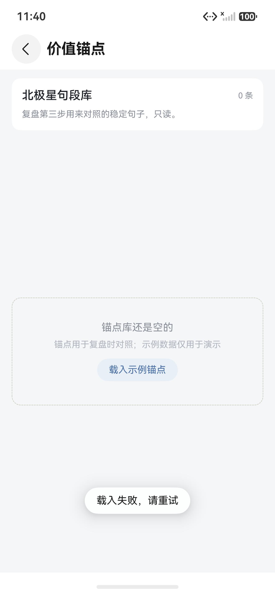

<h1 align="center">cogit-lucid-workbench</h1>

<p align="center">一个把个人复盘过程外化到 HarmonyOS 设备上的元认知工作台。</p>

<p align="center">
  <a href="./README.md">English</a> | <a href="./README.zh-CN.md">简体中文</a>
</p>

<p align="center">
  <a href="LICENSE"></a>
</p>

平时在脑子里跑的那套流程——先记下来，再解释，过一阵校准，最后对照自己相信的东西——这个应用给它一个本地的落脚点。它面向单机、单人使用，不做社交，也不做团队看板。

仓库里是课程版。核心流程已经实现，并在 HarmonyOS 模拟器上跑过。上架华为应用市场不在这个仓库的范围内。

## 亮点

| 亮点 | 具体做了什么 |
|---|---|
| 随手记，不打断 | 决策、人际、情绪、身体四类模板，外加自由速记；可打标签、设密级、关联关系。 |
| 预测要到期结算 | 判断先落盘，保存后不可改；到期结算，命中率进入统计。 |
| 四步复盘 | 事实、解释、矛盾、行动；勾选的价值锚点会跟复盘结果一起保存。 |
| 三种复盘 Agent | 离线模板、本地 Mock、OpenAI 兼容模型；调用失败自动回退模板。 |
| 关系有边界 | 信任分层、互动记录、速记/决策反查，以及一张以「我」为中心的星图。 |
| 记录留在本地 | `relationalStore` 是唯一事实源；Markdown 导出覆盖七类记录。 |

## 当前状态

- 课程版，FR1–FR8 均已实现。
- 已在 HarmonyOS 手机模拟器上验证：HAP 构建、安装、启动、页面跳转、本地 Mock、图表与 Markdown 导出。
- 中文产品名尚未定稿，桌面名称仍使用仓库名。
- 暂不支持深色模式、全量关系网络图；仓库里没有应用市场安装包。

## 已实现的功能

| 模块 | 行为 |
|---|---|
| 速记 | 四类模板与自由速记；标签、密级、关联关系。 |
| 预测 | 对象、判断、置信度、结算日、理由；保存后禁改；到期结算、命中率、折线图与环图。 |
| 复盘 | 四步表单、锚点勾选、Agent 建议与填入、周结算卡、历史与详情。 |
| 关系 | 友好 / 真诚 / 透明三档信任、互动记录、可分析边界、关联记录、星图。 |
| 状态 | 睡眠、运动、提示三项读数；最近七次汇总；历史。 |
| 设置与导出 | Provider、端点、模型、月度预算账本、默认密级、Markdown 导出。 |

## 目录结构

```text
entry/src/main/ets/
  pages/          路由页面
  views/          首页组合
  components/     卡片、图表、星图、通用 UI
  note/           速记、模板、草稿、校验
  prediction/     预测规则与统计
  review/         复盘表单、Agent、历史、周结算
  relation/       信任规则与关系视图
  status/         读数与历史
  anchor/         只读价值锚点
  analysis/       纯分析规则与 LLM 适配
  db/             relationalStore 建表与 DAO
  export/         Markdown 过滤、渲染、写文件
  settings/       Preferences、预算账本、设置清洗
mock-server/      本地复盘提示接口
docs/             UI 冻结记录、调试截图
```

## 快速开始

### 环境

- DevEco Studio，已配置 HarmonyOS SDK。工程 `targetSdkVersion` 为 `26.0.0`，兼容 `6.1.1`（API 24）。
- 一台 HarmonyOS 手机模拟器或真机。

### 运行

1. 用 DevEco Studio 打开本仓库。
2. 等工程 Sync 完成。
3. 选中 `entry` 模块，选择模拟器或真机，点运行。

第一屏是首页。模块网格可以进入速记、预测、复盘、锚点、关系、状态和设置；本周结算卡进入本周汇总。

## 本地模型 Mock（可选）

默认的复盘 Provider 是离线模板，不启动服务也能用。要试本地 Mock：

```bash
node mock-server/server.js
hdc rport tcp:4523 tcp:4523
```

模拟器里的 `127.0.0.1` 指向模拟器自己，不是宿主机，所以需要这条反向端口转发。然后在「设置 → 复盘 Agent → 本地模拟」里切换。

模型档使用同一个 OpenAI 兼容地址（默认 `http://127.0.0.1:4523/v1`）。Key 只存在本机 Preferences，不会写进 Markdown 导出。每次模型调用前会按字符估算成本，和当月预算比较后再决定是否放行。

## 调试与验证

### 使用环境

| 项 | 值 |
|---|---|
| IDE | DevEco Studio 26.0 |
| 设备 | Mate 70 Pro 模拟器，1260 × 2720 |
| SDK | target 26.0.0，compatible 6.1.1（API 24） |
| 本地服务 | Node.js Mock，端口 4523 |

### 构建与安装

在项目根目录，先配置好 `DEVECO_SDK_HOME` 与 `JAVA_HOME`：

```bash
node "<DevEco Studio>/tools/hvigor/bin/hvigorw.js" assembleHap --mode module -p product=default --no-daemon
hdc install -r entry/build/default/outputs/default/entry-default-unsigned.hap
```

这是模拟器和开发者模式设备用的未签名 HAP，不是应用市场安装包。

### 当前验证记录

| 检查 | 结果 |
|---|---|
| HAP 构建 | 通过 |
| 模拟器安装与启动 | 通过 |
| 页面走查 | 首页、周结算、速记、预测、图表、复盘、Agent、关系、星图、锚点、状态、设置、导出 |
| Markdown 导出 | 24 条记录、2580 字符，包含复盘段 |
| 本地回归 harness | 46 + 17 + 22 + 4 条断言通过；TypeScript strict 检查通过 |

回归 harness 没有入库，所以这里记录的是验证结果，不是可直接复制的公开测试命令。

### 首页


*首次运行后的首页：周结算卡、模块计数和最近速记。*

### 预测统计


*预测统计：命中率折线与已结算占比。图表用 MPChart 画在原生 Canvas 上。*

### 关系星图


*关系星图：以「我」为中心，周围是关系节点，颜色表示信任层级。这是自我中心视图，不是全量网络图。*

### 设置与导出


*模型档：端点、Key 输入、月度预算和本月已用。*


*导出结果：文件名、字符数、记录数。导出文件里包含复盘段。*

### 失败与修复：锚点载入



*修复前：模拟器上载入示例锚点失败，只弹出通用错误提示。*


*修复后：锚点表不再使用保留字 `order`，两条示例锚点正常显示。*

Toast 只说了「载入失败」，设备日志里才是 SQLite 的 `Generic error`。问题在列名：`order` 被改成 `sort_order`，旧库通过 `ALTER TABLE` 迁移。复盘表的 `action` 也踩了同一个坑，现在是 `next_action`。

### 复盘保存


*一次完成的周复盘。保存时会写入四步内容、勾选的锚点 ID 和周期范围。*

### 调试记录

- 短内容页面的 Scroll 内容小于视口时会被垂直居中，速记、周结算、锚点、状态和详情页都出现过顶部大空白；相关页面统一加了 `Alignment.Top`。
- 星图第一版用 `Path` 画连线，真机上线条偏移；现在改为在 `Canvas` 上画边。
- 模拟器访问本地 Mock 要走 `hdc rport` 反向转发；没有转发时，复盘提示面板会正确落到失败态。
- 预测结算页没在最后一轮目视里跑到，因为示例预测还没到期。页面能编译，规则测试覆盖了结算逻辑。
- 真实外部模型端点没有实测；模板档和本地 Mock 档都跑过。

## 文档

| 主题 | 内容 | 链接 |
|---|---|---|
| UI 冻结记录 | 色板、字号、组件规则、目视清单 | [docs/UI_FREEZE.md](docs/UI_FREEZE.md) |
| 调试截图 | README 中使用的截图 | [docs/images/debug](docs/images/debug) |

## 许可证

[AGPL-3.0](LICENSE)
