<h1 align="center">cogit-lucid-workbench</h1>

<p align="center">将「记录 → 复盘 → 校准 → 锚点对照」的元认知循环固化为日常习惯的 HarmonyOS 本地应用。</p>

<p align="center">
  <a href="./README.md">English</a> | <a href="./README.zh-CN.md">简体中文</a>
</p>

<p align="center">
  <a href="./LICENSE"></a>
  
  
  
</p>

## 项目简介

`cogit-lucid-workbench` 的名称由 cogit 与 lucid 组成。cogit 取自拉丁语 cogito（「我思」），语出笛卡尔《第一哲学沉思》的「Cogito, ergo sum」（我思故我在）；lucid 意为清醒、澄明。cogit 与 lucid 组合为「让思考澄明」。

本项目源于一次尝试，将元认知与存在主义两条思路固化为日常习惯。元认知即「对思考的思考」，指对自身认知过程的觉察与调节：先看清自己如何判断，再据此调整判断方式；存在主义则关注另一个问题：人没有预先给定的本性，通过自由与选择定义自我。若把选择交给处境、习俗或「我就是这样的人」，即为萨特所说的自欺。元认知提供记录与复核的方法论，存在主义解释这件事值得做的意义。

在功能上，两条思路分别对应记录与复盘。速记、预测与决策在写下时即固定判断、置信度、理由与结算日；到期核对、按周复盘，并对照价值锚点检查当时的解释是否成立。当时的判断与后来的修订，都保留在记录中。

本项目为单模块 HarmonyOS 应用，应用内标题为 **Cogit Lucid**，桌面标签沿用仓库名，中文名称待定。应用将日常注意到的事件、作出的决定与判断，以及事后复盘保存在本地数据库中，并在后续轮次继续使用。适用于已按周复盘、希望早先判断事后仍可核查的读者。

三项设计使其区别于一般日记：

- **预测一经保存即固定。** 置信度、理由与结算日一次写定；到期结算仅补充结果，事后修改以新版本追加，不覆写当时版本。
- **模型默认不参与。** 记录保存在设备本地数据库；仅当手动切换至本地模拟或模型档位时，复盘 Agent 才会读取。API Key 存放于系统资产库。
- **锚点写下即只读。** 可继续添加句子；已保存的句子不可修改或删除，作为复盘第三步的对照基准。

界面仅提供中文。应用内名称位于 `entry/src/main/ets/theme/AppIdentity.ts`，桌面标签位于 `AppScope/resources/base/element/string.json`。

首页自上而下为身份区（头像、昵称、签名、自定义头衔）、四项摘要（今日速记、待结算、连续记录天数、最近复盘）、读数、本周结算卡、计划卡与六个模块入口；摘要下方的 `数据看板` 打开统计页。

## 项目状态

当前版本覆盖六个记录模块：速记、预测与结算、四步复盘与可选 Agent、关系、锚点、状态读数；计划模块负责组织这些记录，包括目标、可选项目、七日节点与清单。目标详情另提供结算日环、一周一格的节奏条、周/月视图、延续率折线与按模块区分的关联构成。设置页提供页面背景与页面透明度；Markdown 导出写出全部记录；备份与恢复将 `.cogitbackup` 文件交由系统保存框处理；数据看板渲染一份含十二个月明细的远端示例数据。

记录保存在加密的 `relationalStore` 数据库中，共十二张表。设备上无法打开数据库时，首页显示阻塞页并提供重试与退出，不会改写为明文库；仅当运行环境不提供 `relationalStore`（DevEco 预览器返回 801）时，首页才退回内存中的演示数据，并在摘要处标明。

应用仅含一个模块，`targetSdkVersion` 26.0.0，最低兼容 6.1.1（API 24），设备类型仅声明 `phone`，浅色与深色两套配色跟随系统。设备测试七条用例，本地检查脚本覆盖纯函数与服务层，详见「测试」一节。已知限制：界面仅提供中文；数据看板读取远端示例文件，不读取本地记录；模型档位需自备端点与 Key。

## 核心功能

| 功能 | 作用 |
|---|---|
| 预测日志 | 目标、判断、0–100 置信度、理由与结算日一次写定；结算时补充结果并标记命中与否。 |
| 命中率统计 | 整体命中率、最近六个月的逐月趋势，以及命中与未命中的环图，由 `@ohos/mpchart` 绘制。 |
| 数据看板 | 十张图共用一份远端数据：校准曲线、月度命中率、结果分布、置信度分布、期限分档、读数趋势、睡眠分组命中率、互动频率、读数覆盖率与速记时段热力图。月份 chip 用于选择十二个月中的一个月，所有图表读取该月明细。页面仅渲染远端示例，不读取本地记录。 |
| 加密本地库 | 十二张表存放于加密的 `relationalStore` 数据库。无法打开时，首页显示阻塞页并提供重试与退出，不会改写为明文库。 |
| 预览器演示 | 仅当运行环境不提供 `relationalStore`（DevEco 预览器返回 801）时，首页改读内存预览数据，并标明摘要为演示数据。 |
| 四步复盘 | 事实、解释、矛盾、行动；矛盾一步勾选价值锚点，用于检验解释。 |
| 计划阶梯 | 目标、可选项目、七日节点与清单。同一时间仅有一个主目标；结束节点时，未完成条目带入下周，并为该节点生成复盘草稿。目标详情另提供结算日环、一周一格的节奏条、周/月视图、延续率折线与按模块区分的关联构成。 |
| 双向关联 | 计划节点可从六个模块中选择记录；六个模块的详情页也可将当前记录关联至任意节点。 |
| 三层信任 | 每条关系标注友好、真诚、透明之一，以本人为中心绘制为星图。 |
| 阈值读数 | 睡眠低于 6.5 小时、运动为零、凌晨报警一次，任一条件命中即在状态面板提示。 |
| Markdown 导出 | 八段记录渲染为一份 Markdown，先写入沙箱，再交由系统保存框另存；计划中指向封存记录的关联仅输出占位文字。 |
| 备份与恢复 | 数据库快照、身份、设置与背景图打包为一个 `.cogitbackup`；恢复前自动保留当前库副本；API Key 不进入备份。 |
| 主页身份区 | 头像、昵称、签名与自定义头衔，下方为四项摘要：今日速记、待结算、连续记录天数与最近复盘。 |
| 页面背景与透明度 | 一张全局默认图，或每个页面各一张；来源可为相册、相机或文件。背景浓淡 4%–30%，页面底色透明度 0%–60%，无图片时同样生效。 |

## 架构

依赖方向仅有一条：自最上层的交互向下至最底层的模型。每层仅调用其下层；`analysis/` 仅 import `model/` 的类型，规则无需数据库与界面即可单独验证。`app/` 存放跨页面的刷新通道与数据库健康状态。

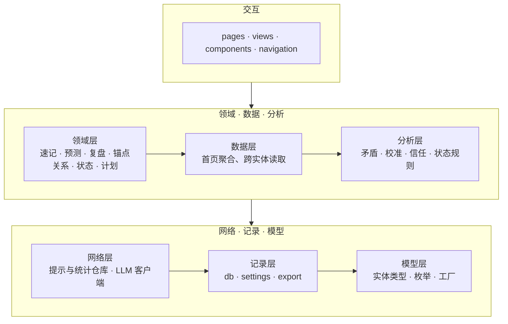

- 页面采用 ArkTS 与状态管理 V2（`@ComponentV2`、`@Local`、`@Param`）；实体模型与服务采用普通 TypeScript。
- 路由由 `NavPathStack` 承载，32 个路由名集中于 `entry/src/main/ets/navigation/Routes.ts`；新增页面仅需在 `Index.pageMap` 中增加分支。当前含 34 个页面文件与 33 个可复用组件。
- `relationalStore` 为唯一事实源并已加密；`Preferences` 保存非敏感设置，模型密钥存放于系统资产库，Markdown 导出由 `fileIo` 写入。
- 运行时依赖仅 `@ohos/mpchart` 3.1.0-rc.0；图标使用系统字形，未引入图标包。
- `components/charts/` 在 mpchart 之上封装折线、柱状与饼图，热力图由 Canvas 绘制；`network/RemoteStatsRepository` 先请求 Gitee，再请求 GitHub。
- `preview/` 提供内存演示数据，使页面在 DevEco 预览器中亦可渲染；数据库可用时，没有页面会读取该数据。
- `profile/` 负责主页身份：昵称、签名、头衔三个文本字段与头像路径经由 Preferences 保存，头像图片单独走 320 方形图流程。

## 使用示例

首页自上而下为身份区与四项摘要，其下为当天读数、本周结算卡或新装引导卡、计划卡，以及六个模块入口；`编辑` 与 `设置` 位于身份区右侧。

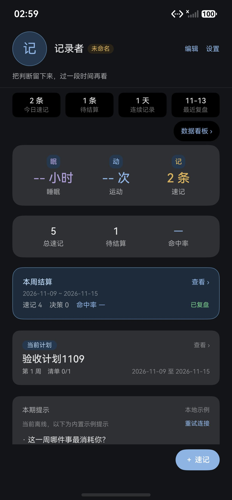

### 设置身份

1. 点击身份区右侧的 `编辑`。
2. 头像可从相册、拍照或文件中选择；图片居中裁切为 320 方形，保存至应用沙箱。
3. 填写昵称（最多 12 字）、签名（24 字）与头衔（8 字）。
4. 点击 `保存`。身份区立即更新，重启后仍然保留。

预期结果：顶栏显示新的头像与文字；昵称或头衔留空时，分别显示为 `记录者` 与 `未命名`。

### 记一条预测

1. 进入预测模块（`预测`）。列表将待结算项按到期日排列在前，已结算项按创建时间排列。
2. 点击 `+`，填写目标、判断、0 到 100 的置信度、理由与结算日。
3. 保存。自此记录仅追加：再次修改会新增一个版本，不覆盖原有记录。
4. 到期后打开详情页，填写结果并标记命中或未命中。
5. 进入预测统计（`预测统计`）查看整体命中率、趋势与命中占比。

预期结果：结算两三条后，统计页绘制趋势线与环图；尚未结算时，命中率显示破折号，并在旁边标明样本量。

### 打开数据看板

1. 在首页四项摘要下方点击 `数据看板`。
2. 页面请求公开仓 `docs/mock/` 下的 `stats-12m.json`，绘制十张图：月度命中率、校准曲线、结果分布、置信度分布、期限分档、读数趋势、睡眠分组命中率、互动频率、读数覆盖率与速记时段热力图；看板不读取本地记录。
3. 点击月份 chip 切换月份，页头与所有图表均读取该月明细；点击 `刷新` 重新请求远端数据。
4. Gitee 与 GitHub 均请求失败时，页面保留错误文案与重试入口。

预期结果：页头显示远端数据时间与当前月份；校准曲线沿 45 度参考线展开；切换月份后，校准、结果、读数与两张热力图一并变化；热力图带有星期与列标签。

### 做一次复盘

1. 进入复盘模块（`复盘`），选择周复盘或月复盘。两个 Tab 各自保存草稿。
2. 按四步依次填写：事实、解释、矛盾、行动。事实与行动为必填项。
3. 矛盾一步可勾选价值锚点，用于检验解释。
4. 如需，可打开 Agent 面板生成矛盾候选。模板档位离线可用；本地模拟与模型档位会请求端点。
5. 保存。该周期显示为已完成，本次复盘进入历史。

### 排一周的计划

1. 计划卡位于本周结算卡下方。尚无目标时点击 `新建`；此后点击 `查看 ›` 进入当前目标。
2. 填写标题与起始日期，起始日期归入当周周一。结束日期可留空，仅按周推进；也可设为晚于该周周一的日期，用于计算倒计时。
3. 进入本周节点添加清单条目，点击条目标记完成。节点顶部显示本周剩余天数，清单上方显示「完成 / 延续 / 新加」三段条。
4. 如需，可在目标内新建项目并将节点归入该项目。项目可改名或删除；删除后节点回到未分组，条目保留。
5. 点击 `结束本周`。未完成条目带入下一周，同时为该节点预填复盘草稿；`去复盘` 携带节点信息进入复盘页，复盘页保留 `返回节点`。
6. 点击 `关联记录`，从六个模块中选择记录。选择器会标出同周记录，按共同关系与标签排序，并提供关键词搜索与 `加载更多`。

预期结果：仅有一个目标带 `主目标` 标记。设置结束日时，目标详情显示结算日环；未设置时显示 `已推进 N 周`。页面另含一周一格的节奏条、周/月视图；清单满三周后出现延续率折线，以及按模块区分的关联构成。

### 设置页面背景

1. 进入设置（`设置`），点击 `打开页面背景`。
2. 选择来源：`从相册选择`、`拍一张` 或 `选择文件`。图片转为 PNG，长边压缩至 1080×1920 以内后保存。
3. 返回应用页，将图片设为 `全部页面（默认）`，或勾选目标页面后点击 `应用`。
4. 拖动 `背景浓淡`（4%–30%），使图片在卡片后方不影响文字辨识；再拖动 `页面透明度`（0%–60%）调整页面底色。两者均可作用于全部页面，或仅作用于勾选页面。

预期结果：再次进入对应模块时，卡片后方显示该图片。透明度为 0% 时页面为实色；调高后，无论是否设置图片，均可透出后方的系统壁纸。

### 把记录取出来

设置页（`设置`）将整份记录写为 `cogit-export-YYYYMMDD-HHMM.md`，写入后立即弹出系统保存框，选定目录即完成另存；取消保存时，文件保留在沙箱内，页面仍报出文件名、字符数与条数，此后可点击 `分享` 发出。封存记录不写入文件。

## 运行截图

截图取自 Mate 70 Pro 模拟器与当前版本，深色模式，记录均为合成示例。

| 首页 | 看板 · 当前月 |
|---|---|
|  | 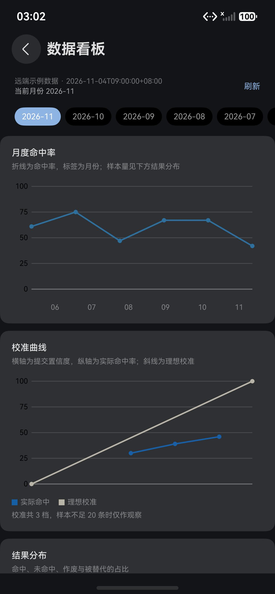 |
| **看板 · 中部** | **看板 · 底部** |
| 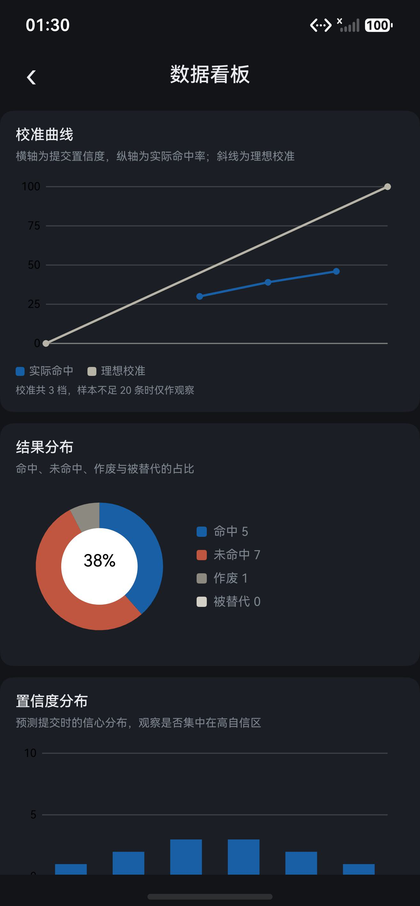 | 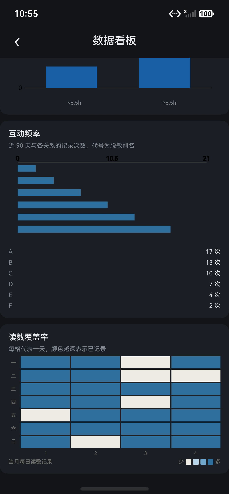 |
| **目标详情** | **复盘详情** |
| 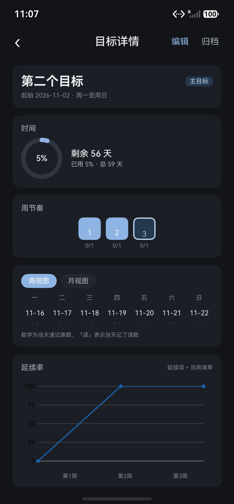 | 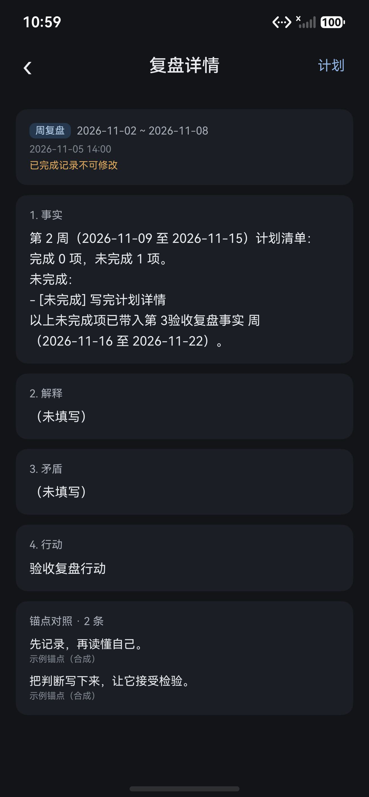 |
| **价值锚点** | **关系图谱** |
| 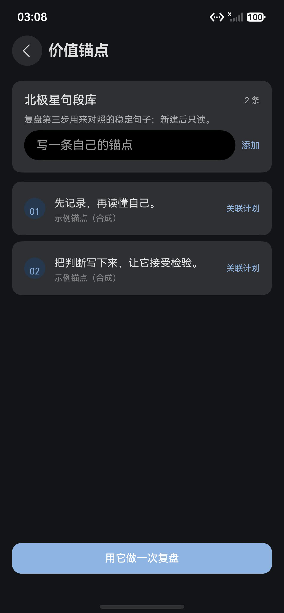 | 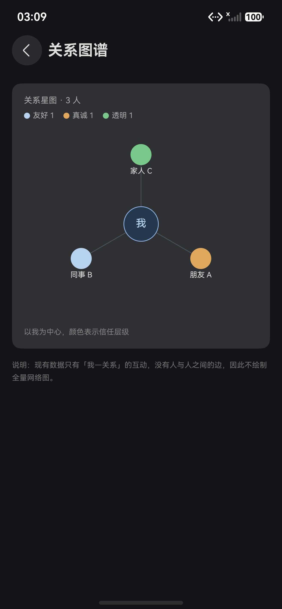 |
| **设置 · 模型档** | **导出结果** |
| 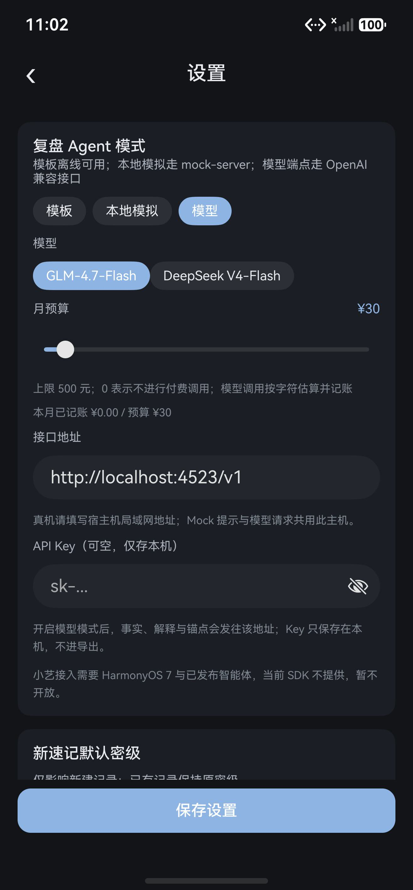 | 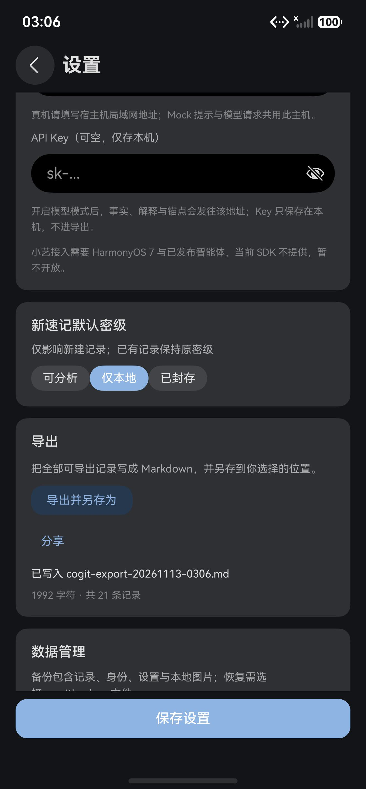 |

## 快速安装

### 环境

- 已安装 HarmonyOS SDK 的 DevEco Studio，SDK 需包含 API 26（`targetSdkVersion` 26.0.0）；应用自 6.1.1（API 24）起可运行。
- 一台 HarmonyOS 手机模拟器或真机；`deviceTypes` 仅声明 `phone`。
- 仅在使用本地 Mock 服务时需要安装 Node.js；下述 hvigor 命令使用 DevEco Studio 自带的 Node.js。

### 获取代码

```bash
git clone git@github.com:SunshineMahiru/cogit-lucid-workbench.git
cd cogit-lucid-workbench
```

镜像地址：`git@gitee.com:theangelnextdoor/cogit-lucid-workbench.git`。

### 安装依赖

在 DevEco Studio 中打开工程，等待 Sync 完成。运行时依赖为 `@ohos/mpchart` 3.1.0-rc.0；`@ohos/hypium` 与 `@ohos/hamock` 仅用于测试。三者均记录在 `oh-package.json5` 中。

亦可在项目根目录使用命令行构建：

```bash
node "<DevEco Studio>/tools/hvigor/bin/hvigorw.js" assembleHap --mode module -p product=default --no-daemon
```

需先将 `DEVECO_SDK_HOME`、`NODE_HOME`、`JAVA_HOME` 指向 DevEco 工具链。产物位于 `entry/build/default/outputs/default/`。仓库内的 profile 不含签名配置；缺少本地签名文件时，产出为 `entry-default-unsigned.hap`。

## 快速开始

1. 在 DevEco Studio 中打开工程，等待 Sync 完成。
2. 启动手机模拟器，或连接真机。
3. 选择 `entry` 模块运行。启用自动签名时，DevEco 使用调试证书签名；否则需先补充 `signing/signing.local.json`（见「签名」）。
4. 点击右下角 `＋ 速记`，写入一行并保存。模块入口中的 `速记` 打开同一编辑器，需先将首页滑动至底部。
5. 该速记出现在「最近速记」中，四项摘要不再为零。
6. 点击 `数据看板`，再点击任一月份 chip，确认远端数据可加载且图表随月份切换。

预期结果：今日速记与总速记各 1 条，本周结算卡开始计数，看板显示远端数据时间并绘制十张图。请求失败时，页面保留错误文案与重试入口。

DevEco 预览器可渲染页面，但不提供 `relationalStore`；记录类页面在该环境下显示演示内容，摘要为空。查看真实数据请使用模拟器或真机。

## 配置

### Mock 服务与联调地址

复盘提示面板与本地模拟档的补全请求，均发送至 `mock-server/` 中的零依赖 Node 服务。

```bash
node mock-server/server.js
```

默认监听 `0.0.0.0:4523`；可通过环境变量修改端口：`PORT=8080 node mock-server/server.js`。

| 方法 | 路径 | 返回 |
|---|---|---|
| GET | `/health` | `{ "status": "ok" }` |
| GET | `/review-prompts?period=week` | `{ "prompts": [...] }`，`period=month` 换成月度提示 |
| POST | `/llm/complete` | 本地模拟档用的补全结果 |
| POST | `/v1/chat/completions` | OpenAI 兼容格式，读 `choices[0].message.content` |

请求地址有三种来源：

- 复盘提示：读取设置中的接口地址，去掉结尾的 `/v1` 作为 Mock 根地址。设置未修改时等于 `http://localhost:4523`。
- 本地模拟：固定为 `http://localhost:4523/llm/complete`，定义在 `network/ApiConfig.ts` 中，修改设置不影响该档位。
- 模型档：接口地址原样使用，客户端自行拼接 `/chat/completions`。

| 运行环境 | `localhost:4523` 能否直连 | 做法 |
|---|---|---|
| DevEco 预览器 | 可以 | 默认地址直接可用 |
| 模拟器 | 不可以，`127.0.0.1` 指向模拟器自身 | 执行 `hdc rport tcp:4523 tcp:4523`；转发后提示与本地模拟均可连接，也可将接口地址改为宿主机地址 |
| 真机 | 不可以 | 复盘提示依赖设置中的宿主机地址，未配置时退回三条本地提示；本地模拟地址固定，在真机上不可用，联调请使用模型档 |

注意事项：

- 明文 HTTP 默认关闭；`entry/src/main/resources/base/profile/network_config.json` 仅放行 `127.0.0.1` 与 `localhost`。真机如需通过 HTTP 访问 Mock，须将宿主机地址加入该文件，且不要提交此行改动。
- 超时分为三档：复盘提示 5 秒，本地模拟补全 8 秒，模型档 20 秒。
- `hdc rport` 仅在当前连接内有效，模拟器重启后需重新转发。

### 远端统计 JSON

看板不读取本地数据库；图表数据仅有一个来源：公开仓 `docs/mock/` 中的静态 JSON。无需密钥，页面标明该数据为示例数据。

| 文件 | 内容 |
|---|---|
| `stats-12m.json` | 12 个月度点，加每个月一份明细：校准、结果、置信度、期限、读数、覆盖、睡眠分组、互动与时段格子 |

基础地址：

- Gitee：`https://gitee.com/theangelnextdoor/cogit-lucid-workbench/raw/main/docs/mock/`
- GitHub：`https://raw.githubusercontent.com/SunshineMahiru/cogit-lucid-workbench/main/docs/mock/`

`RemoteStatsRepository` 先请求 Gitee，失败后再请求 GitHub，并附带跳过缓存的 `t` 参数。两者均失败时，页面保留错误文案与重试入口。切换月份仅过滤已加载的月度明细，不会重新发起请求。

### 页面背景与透明度

| 项 | 说明 |
|---|---|
| 入口 | 设置 → `页面背景` → `打开页面背景` |
| 来源 | 相册、相机，或限定图片后缀的文件选择器。三种来源均先转为 PNG，长边压缩至 1080×1920 以内 |
| 作用范围 | 选定图片后勾选目标页面，可仅作用于一个模块，也可一次作用于多个。未单独设置图片的页面使用默认图；清除后回到默认图 |
| 浓度 | 4%–30%，默认 10%。数值越高，图片越明显，正文可读性相应下降 |
| 透明度 | 0%–60%，默认 0%。勾选页面时修改这些模块的取值；未勾选时修改全局值 |
| 存放 | `${filesDir}/page-backgrounds`，按内容哈希命名，同一张图仅存一份；启动时清理无页面引用的文件 |
| 深色模式 | 浓度乘以 0.7，并叠加一层黑色蒙版，避免图片在深色背景下过亮 |

透明度不依赖图片，调整的是页面底色自身的 alpha。窗口创建时使用透明底色，因此页面透明后可透出窗口后方内容。某个模块单独调整后，点击「恢复跟随」交回全局值。

### 主页身份

| 项 | 说明 |
|---|---|
| 入口 | 身份区右侧的 `编辑` |
| 字段 | 昵称最多 12 字，签名 24 字，头衔 8 字；昵称或头衔留空时分别显示为 `记录者` 与 `未命名` |
| 头像 | 相册、拍照或文件；居中裁切为 320×320 PNG，保存至 `${filesDir}/profile`，替换时删除旧图 |
| 存储 | Preferences 库 `cogit_profile`，四个字段均不涉及密钥 |
| 刷新 | 设置 → `数据管理` → `刷新首页数据`，重新读取四项摘要 |

### 复盘 Agent 三档

| 档位 | 请求目标 | 说明 |
|---|---|---|
| 模板 | 不请求 | 默认档位，离线可用 |
| 本地模拟 | `http://localhost:4523/llm/complete` | 无需 Key。地址固定，真机上不可用；联调请使用模型档 |
| 模型 | `{接口地址}/chat/completions` | 需要接口地址、模型名与 API Key |

默认值：接口地址 `http://localhost:4523/v1`，月度预算 30 元，上限 500 元。模型名可选 `GLM-4.7-Flash` 与 `DeepSeek V4-Flash`，默认为前者。

API Key 保存至系统密钥库（Asset Store），Preferences 中留空。密钥库写入失败时保存直接报错，不会退回明文。Key 不进入导出。

预算为 0 时仅模板档可用：本地模拟与模型档均不发起请求，直接退回模板。费用按字符数估算并记入月度账本。预算用尽或请求失败时，本次复盘同样退回模板档。

### 密级

| 密级 | 新建记录的默认值 | 进入模型上下文 | 进入导出 |
|---|---|---|---|
| `analyzable` | 否 | 切到模型档后可以 | 是 |
| `local_only` | 是 | 否 | 是 |
| `sealed` | 否 | 否 | 否 |

密级逐条记录单独选择。设置页的默认值仅作用于此后新建的记录，不回填已有数据。

### 签名

仓库跟踪的 `build-profile.json5` 有意保留空的 `signingConfigs`。构建时，`hvigorfile.ts` 检查 `signing/signing.local.json`，存在则读取并注入 `default` 签名配置。该文件与 `*.p12`、`*.cer`、`*.p7b` 均在忽略列表中，因此新克隆的仓库构建产物为未签名 HAP。

本地签名步骤：

1. 将 `docs/signing.local.example.json` 复制为 `signing/signing.local.json`。
2. 填写证书、profile、keystore 路径，以及 DevEco 生成的 `keyPassword` / `storePassword` 密文。文档中这几项为密文；除非本机 hvigor 版本接受明文，否则不要直接写入明文。
3. 重新构建，确认 `entry/build/default/outputs/default/` 下生成 `entry-default-signed.hap`。

### 导出

设置页将事件、决策、关系、预测、锚点、状态读数、复盘结果与计划写为一份 Markdown，文件名形如 `cogit-export-20261027-0845.md`。点击 `导出并另存为` 弹出系统保存框，选定目录即完成另存；取消保存时，文件保留在沙箱的 `${filesDir}/exports`，此后仍可点击 `分享` 发出。

封存记录不写入文件。计划中指向封存记录的关联仅输出 `已封存记录` 占位。设置结束日的计划会多出一行 `结束：`。

### 备份与恢复

| 项 | 说明 |
|---|---|
| 入口 | 设置 → `数据管理` → `备份并另存` / `恢复备份` |
| 备份产物 | 一个 `cogit-backup-<时间戳>.cogitbackup`，本质上是 JSON：数据库快照、身份与头像、设置、各页面背景图与透明度 |
| 存到哪 | 生成后立即弹出系统保存框，选定目录即完成保存；取消时提示「已生成备份，但未另存」 |
| 恢复顺序 | 先校验版本与数据库文件，再为当前库保留一份 `pre-restore-*.db`，随后依次恢复数据库、身份、设置与背景图，最后通知首页与页面刷新 |
| 不随备份走 | API Key。打包前该字段被清空，恢复时仅写入非密钥项，新设备上需重新填写 |

同一卡片还提供 `清空全部数据`：首次点击变为 `确认清空`，再次点击方才执行。清除范围为十二张表的记录、设置、身份、背景图、沙箱内的导出与备份文件，以及本机保存的 API Key；已另存至手机目录的文件不受影响。

## 目录结构

```text
cogit-lucid-workbench/
├── AppScope/                       bundle 名、版本、桌面图标
├── entry/                          唯一的模块
│   ├── src/main/
│   │   ├── ets/
│   │   │   ├── entryability/       应用入口，同时打开数据库
│   │   │   ├── pages/              34 个页面文件；Index.ets 承载路由
│   │   │   ├── views/              首页组合视图
│   │   │   ├── components/         33 个可复用组件
│   │   │   │   └── charts/         折线、柱状、饼图封装与 Canvas 热力图
│   │   │   ├── navigation/         路由名、参数类型与转场钩子
│   │   │   ├── model/              实体类型、枚举、工厂与示例数据
│   │   │   ├── data/               首页聚合与跨实体读取
│   │   │   ├── app/                数据库健康状态、首页与身份刷新总线
│   │   │   ├── preview/            预览器演示数据
│   │   │   ├── profile/            身份存储与头像流程
│   │   │   ├── note/               速记、模板、草稿与校验
│   │   │   ├── prediction/         预测与结算
│   │   │   ├── review/             复盘流程与 Agent
│   │   │   ├── anchor/             价值锚点
│   │   │   ├── relation/           人物与关系
│   │   │   ├── status/             状态读数
│   │   │   ├── plan/               目标、周节点与可视化取值
│   │   │   ├── analysis/           规则、分析器与 LLM 适配器
│   │   │   ├── db/                 12 张表的建表语句、8 个 DAO、容错 JSON
│   │   │   ├── settings/           设置项、页面背景、密钥库与预算账本
│   │   │   ├── export/             Markdown 分段与文件写入
│   │   │   ├── network/            提示与统计仓库、HTTP 与 LLM 客户端
│   │   │   └── theme/              设计令牌与应用标识
│   │   └── resources/              base 与 dark 两套资源，含网络配置
│   ├── src/test/                   Hypium 单元测试
│   └── src/ohosTest/               设备测试，含看板 UiTest 流程
├── mock-server/                    零依赖 Node Mock 服务
├── hvigor/                         构建器配置
├── signing/                        本地签名配置与材料（已忽略）
├── docs/                           项目说明、UI 冻结记录、截图、看板 JSON 与签名模板
├── build-profile.json5             SDK 版本、产物与构建模式
├── hvigorfile.ts                   构建脚本，本地存在签名配置时注入
├── oh-package.json5                依赖声明
├── code-linter.json5               静态检查规则
└── LICENSE                         AGPL-3.0
```

新增页面需改动三处：`navigation/Routes.ts` 中添加路由名，`pages/` 下放置页面文件，并在 `pages/Index.ets` 的 `pageMap` 中接入。

## 测试

用例分为两处：`entry/src/test` 的本地单测在电脑上运行，`entry/src/ohosTest` 的设备套件需安装至模拟器或手机。

| 套件 | 文件 | 条数 | 覆盖 |
|---|---|---|---|
| 本地单测 | `src/test/List.test.ets` | 4 | 预测表单校验 2 条、置信度校准分档、导出密级过滤 |
| 设备 · 分析 | `src/ohosTest/ets/test/Analysis.test.ets` | 4 | 与本地那 4 条同源，在设备上重跑一遍 |
| 设备 · 流程 | `src/ohosTest/ets/test/UiFlow.test.ets` | 3 | 从首页进看板、切月份、返回首页 |

本地单测：

```bash
node "<DevEco Studio>/tools/hvigor/bin/hvigorw.js" test -p module=entry --no-daemon
```

设备套件需先安装应用包与测试包，再交由 `aa test` 执行：

```bash
node "<DevEco Studio>/tools/hvigor/bin/hvigorw.js" assembleHap --mode module -p module=entry@ohosTest -p product=default --no-daemon
hdc install -r entry/build/default/outputs/default/entry-default-signed.hap
hdc install -r entry/build/default/outputs/ohosTest/entry-ohosTest-signed.hap
hdc shell aa test -b com.sunshinemahiru.cogitlucid -m entry_test -s unittest OpenHarmonyTestRunner -w 10000
```

预期输出：`Tests run: 7, Failure: 0, Error: 0, Pass: 7`。

需要注意两点：`hvigorw test` 仅支持 Windows 与 macOS，Linux 暂不支持；`aa test` 未指定超时时默认为 5 秒，流程用例包含界面操作，因此需以 `-w 10000` 放宽至 10 秒。

## 文档

| 主题 | 内容 | 链接 |
|---|---|---|
| 项目蓝图 | 定位、范围、两套交付物，以及各阶段的取舍理由 | [docs/PROJECT.md](./docs/PROJECT.md) |
| 视觉令牌 | 锁定的颜色、字号、圆角、间距，逐页目视清单与已知差异 | [docs/UI_FREEZE.md](./docs/UI_FREEZE.md) |
| Mock 服务 | 端点、寻址方式，预览器与模拟器的区别 | [mock-server/README.md](./mock-server/README.md) |
| 本地签名模板 | `signing/signing.local.json` 的占位配置 | [docs/signing.local.example.json](./docs/signing.local.example.json) |

## 常见问题

**记录存放在哪里，是否会上传？**
十二张表均保存在本机 `relationalStore` 中，整库加密，密钥由系统托管。默认的模板档完全不联网；切换至模型档后，仅 `analyzable` 的文本会发送至所填接口地址。`sealed` 既不进入模型上下文，也不进入导出。

**更换手机时如何迁移记录？**
设置 → `数据管理` → `备份并另存`，得到一个 `.cogitbackup` 文件，内含数据库快照、身份、设置与背景图。新设备安装应用后选择 `恢复备份`，恢复前会自动保留一份 `pre-restore-*.db`。API Key 不随备份迁移，需在新设备上重新填写。

**导出的 Markdown 位于何处？**
点击 `导出并另存为` 会弹出系统保存框，选定目录即可。取消保存时，文件保留在沙箱的 `${filesDir}/exports`，此后仍可点击 `分享` 发出。

**预览器中首页空白，或报告数据库错误。**
DevEco 预览器不提供 `relationalStore`。数据库无法打开时，首页改读内存中的演示数据，并在摘要下方标明；其他依赖数据的页面各有回退方案。查看真实记录请使用模拟器或手机。

**数据看板显示示例数据。**
看板读取公开仓 `docs/mock/` 下的 `stats-12m.json`，先请求 Gitee，再请求 GitHub，页头标明该数据为示例数据。修改此文件即可改变图表内容。

**模拟器无法连接 Mock 服务。**
模拟器中的 `127.0.0.1` 指向模拟器自身。先执行 `hdc rport tcp:4523 tcp:4523` 完成端口转发；真机则需在设置中将接口地址填写为宿主机地址。

**构建出的 HAP 无法安装。**
缺少本地签名文件时，`assembleHap` 产出 `entry-default-unsigned.hap`，无法安装。请参照 `docs/signing.local.example.json` 创建 `signing/signing.local.json`，或在 DevEco Studio 中配置签名后重新构建。仓库中的 `build-profile.json5` 有意不含签名信息。

**桌面名称与应用内标题不一致。**
桌面标签 `cogit-lucid-workbench` 来自 `AppScope/resources/base/element/string.json`，应用内标题 `Cogit Lucid` 来自 `theme/AppIdentity.ts`。中文名称尚未确定，两处均为占位。

**点击「拍一张」时报错。**
系统相机选择器需要设备安装相机应用；模拟器通常不包含相机应用，此时请改用相册或文件。

**页面调透明后透出的是壁纸。**
窗口创建时使用透明底色，降低页面透明度仅会透出窗口后方的内容，无法读取其他应用的数据。

**是否支持深色模式？**
支持。`theme/AppTheme.ts` 为浅色与深色各维护一套令牌；启动时读取系统设置，系统切换时重新应用。深色模式下背景图会降低浓度，并叠加一层黑色蒙版。

**为何只有一个运行时依赖？**
图表由 `@ohos/mpchart` 绘制于原生 Canvas，未引入 Web 组件，也未引入第三方图标包；包体因此较小，同时避免素材授权问题。

## 贡献指南

欢迎参与本项目。如有新颖且实用的想法，或计划进行较大改动，请先在 issue 中说明；小修小补暂不建议直接提交 PR。

- 提交信息遵循 Conventional Commits：`type(scope): subject`，subject 使用英文，正文说明原因。
- 一个提交只做一件事。较大功能分为若干步骤，每一步均可单独验证。
- 代码注释使用英文；界面文案使用中文，与现有页面保持一致。
- 不引入第三方 UI 组件库，组件均在 `components/` 中自行实现。
- 新增页面需改动三处：`navigation/Routes.ts` 添加路由名，`pages/` 放置页面文件，`pages/Index.ets` 的 `pageMap` 中接入。
- 不要提交真实记录、包含真实姓名或头像的截图，以及 `.cogitbackup` 备份文件。演示数据请写入 `model/` 的示例数据。
- 签名材料、HAP 与日志均不进入提交，`.gitignore` 已覆盖。
- 提交 PR 前请执行 `code-linter.json5` 的规则、`assembleHap`，以及「测试」一节中的两套用例，并在 PR 中说明验证方式。

`main` 为唯一开发分支，与 GitHub、Gitee 两个远端保持同步。issue 可在任一端提交，合并后由维护者同步。

## 许可证

本项目以 [GNU Affero 通用公共许可证第三版](./LICENSE) 发布。

AGPL 较 GPL 多一项要求：修改后的版本若通过网络对外提供服务，须向使用者提供修改后的源码；仅在本地使用时不涉及此条。

运行时依赖仅 `@ohos/mpchart`，采用 Apache License 2.0，许可证文本随依赖分发；`@ohos/hypium` 与 `@ohos/hamock` 仅用于测试，位于 `devDependencies`。

版权所有 (c) 2026 SunshineMahiru（曦昼Sunshine）。
