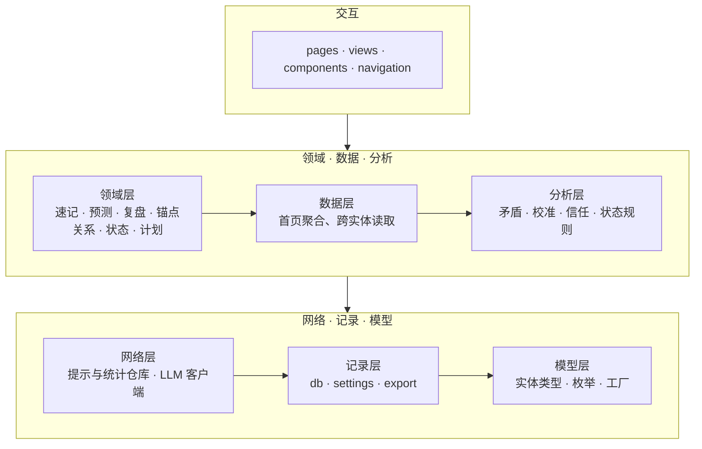

<h1 align="center">cogit-lucid-workbench</h1>

<p align="center">把「记录 → 复盘 → 校准 → 锚点对照」的元认知循环做成日常习惯的 HarmonyOS 本地应用。</p>

<p align="center">
  <a href="./README.md">English</a> | <a href="./README.zh-CN.md">简体中文</a>
</p>

<p align="center">
  <a href="./LICENSE"></a>
  
  
  
</p>

## 项目简介

cogit-lucid-workbench 的含义即 cogit — from Latin "cogito"（我思）, as in "Cogito, ergo sum" — externalizing your own thinking.

cogit 来自拉丁语 cogito（「我思」）——笛卡尔《第一哲学沉思》的 "Cogito, ergo sum"（我思故我在），这是近代哲学与存在主义的起点。项目核心是「元认知」，而「元认知」的字面意思就是「对思考的思考」——cogit（思考）+ lucid（清醒/澄明）精确表达「让思考澄明」，高于 self（自我）。

它是一个单模块 HarmonyOS 应用，应用内标题为 **Cogit Lucid**，桌面标签仍是仓库名，具体名称待定。它把注意到的事、做过的决定、下过的判断和事后的复盘留在本地数据库里，再把这些记录带进下一轮。适合那些已经在按周复盘、希望早先的判断事后仍然查得到的人。

三个设计决定了它和日记的差别：

- **预测保存即固定。** 置信度、理由和结算日一次写定；到期结算只补结果，事后修改以新版本追加，不覆写当时那一版。
- **模型默认不参与。** 记录在设备本地数据库，只有手动切到本地模拟或模型档位，复盘 Agent 才会读取；API Key 存在系统资产库。
- **锚点写下即只读。** 你可以继续添加句子，已存下的不能改、不能删，充当复盘第三步的对照基准。

界面只有中文。应用内名称在 `entry/src/main/ets/theme/AppIdentity.ts`，桌面标签在 `AppScope/resources/base/element/string.json`。

首页自上而下是身份区（头像、昵称、签名、手填头衔）、四项摘要（今日速记、待结算、连续记录天数、最近复盘）、读数、本周结算卡、计划卡与六个模块入口；摘要下方的 `数据看板` 打开统计页。

## 项目状态

当前版本覆盖六个记录模块——速记、预测与结算、四步复盘与可选 Agent、关系、锚点、状态读数——以及把它们组织起来的计划：目标、可选项目、七日节点与清单。目标详情另有结算日环、一周一格的节奏条、周/月视图、延续率折线与按模块拆分的关联构成。设置里有页面背景与页面透明度，Markdown 导出写出全部记录，备份与恢复把一个 `.cogitbackup` 文件交给系统保存框，数据看板渲染一份含十二个月明细的远端示例数据。

记录存在加密的 `relationalStore` 数据库里，共十二张表。真机上打不开时，首页显示阻塞页，提供重试与退出，不会改写明文库；只有运行环境没有 `relationalStore`（DevEco 预览器返回 801）才退回内存里的演示数据，摘要上会标明。

应用只有一个模块，`targetSdkVersion` 26.0.0、最低兼容 6.1.1（API 24），设备类型只声明 `phone`，浅色与深色两套配色跟随系统。设备测试七条用例，本地检查脚本覆盖纯函数与服务层，两处都在「测试」一节说明。已知限制：界面只有中文；看板读远端示例文件，不读本地记录；模型档位需要自备端点与 Key。

## 核心功能

| 功能 | 作用 |
|---|---|
| 预测日志 | 目标、判断、0–100 置信度、理由与结算日一次写定；结算时补上结果并标记命中与否。 |
| 命中率统计 | 整体命中率、最近六个月的逐月趋势、命中与未命中的环图，用 `@ohos/mpchart` 绘制。 |
| 数据看板 | 十张图共用一份远端数据：校准曲线、月度命中率、结果分布、置信度分布、期限分档、读数趋势、睡眠分组命中率、互动频率、读数覆盖率与速记时段热力图；月份 chip 选择十二个月中的一个月，所有图读取该月明细。页面只渲染远端示例，不读本地记录。 |
| 加密本地库 | 十二张表存在加密的 `relationalStore` 数据库里。打不开时首页显示阻塞页，提供重试与退出，不会改写明文库。 |
| 预览器演示 | 只有运行环境没有 `relationalStore`（DevEco 预览器返回 801）时，首页才改读内存预览数据，并标明摘要是演示数据。 |
| 四步复盘 | 事实、解释、矛盾、行动；矛盾这一步勾选价值锚点，用它们检验自己的解释。 |
| 计划阶梯 | 目标、可选项目、七日节点与清单。同一时间只有一个主目标；结束节点时未完成的条目带入下周，并为该节点写好复盘草稿。目标详情另有结算日环、一周一格的节奏条、周/月视图、延续率折线与按模块拆分的关联构成。 |
| 双向关联 | 计划节点可以从六个模块里挑记录，六个模块的详情页也能把当前记录挂到任意节点。 |
| 三层信任 | 每条关系带友好、真诚、透明之一的分层，以我为中心画成星图。 |
| 阈值读数 | 睡眠低于 6.5 小时、运动为零、凌晨报警一次，任一命中就在状态面板提示。 |
| Markdown 导出 | 八段记录渲染成一份 Markdown，先写沙箱再弹系统保存框另存；计划里指向封存记录的关联只输出占位文字。 |
| 备份与恢复 | 数据库快照、身份、设置与背景图打包成一个 `.cogitbackup`，恢复前自动留一份当前库；API Key 不进备份。 |
| 主页身份区 | 头像、昵称、签名与手填头衔，下面跟四项摘要：今日速记、待结算、连续记录天数与最近复盘。 |
| 页面背景与透明度 | 一张全局默认图，或每个页面各一张，来源可以是相册、相机或文件；背景浓淡 4–30%，页面底色可设 0–60% 透明度，没有图片也生效。 |

## 架构

本项目的依赖方向只有一条：从最上面的交互往下走到最底下的模型。每层只调用它下面的层；`analysis/` 只 import `model/` 的类型，规则不需要数据库和界面就能单独验证。`app/` 放跨页面的刷新通道与数据库健康状态。



- 页面用 ArkTS 与状态管理 V2（`@ComponentV2`、`@Local`、`@Param`）；实体模型与服务用普通 TypeScript。
- 路由走 `NavPathStack`，32 个路由名集中在 `entry/src/main/ets/navigation/Routes.ts`，新增页面只往 `Index.pageMap` 加分支；当前 34 个页面文件、33 个可复用组件。
- `relationalStore` 是唯一事实源并已加密；`Preferences` 存非敏感设置，模型密钥放系统资产库，`fileIo` 写 Markdown 导出。
- 运行时依赖只有 `@ohos/mpchart` 3.1.0-rc.0；图标用系统字形，没有引入图标包。
- `components/charts/` 在 mpchart 之上封装折线、柱状、饼图，热力图用 Canvas 绘制；`network/RemoteStatsRepository` 先取 Gitee、再取 GitHub。
- `preview/` 提供内存演示数据，让页面在 DevEco 预览器里也能渲染；数据库可用时没有页面会读它。
- `profile/` 承担主页身份：昵称、签名、头衔三个文本字段和头像路径走 Preferences，头像图片单独走 320 方形图流程。

## 使用示例

首页先显示身份区与四项摘要，下面是当天读数、本周结算卡或新装引导卡、计划卡，以及六个模块入口；`编辑` 与 `设置` 在身份区右侧。


### 设置身份

1. 点身份区右侧的 `编辑`。
2. 头像可从相册、拍照或文件里选；图片会居中裁成 320 方形，存进应用沙箱。
3. 填昵称（最多 12 字）、签名（24 字）、头衔（8 字）。
4. 点 `保存`。身份区立即更新，重启后仍然保留。

预期结果：顶栏换成新的头像与文字；昵称或头衔留空时分别显示为 `记录者` 与 `未命名`。

### 记一条预测

1. 进入预测模块（`预测`）。列表把待结算的按到期日排在前面，已结算的按创建时间排。
2. 点 `+`，填目标、判断、0 到 100 的置信度、理由和结算日。
3. 保存。从这一刻起记录只追加：之后再改会新增一个版本，不会覆盖原来那条。
4. 到期后打开详情页，填上结果，标记命中或未命中。
5. 进预测统计（`预测统计`）看整体命中率、趋势和命中占比。

预期结果：结算过两三条之后，统计页会画出趋势线和环图；一条都没结算时命中率显示破折号，旁边标明样本量。

### 打开数据看板

1. 在首页四项摘要下方点 `数据看板`。
2. 页面会请求公开仓 `docs/mock/` 下的 `stats-12m.json`，画出十张图：月度命中率、校准曲线、结果分布、置信度分布、期限分档、读数趋势、睡眠分组命中率、互动频率、读数覆盖率与速记时段热力图；看板不读取本地记录。
3. 点月份 chip 切换月份，页头与所有图都会读取该月明细；点 `刷新` 重新请求远端数据。
4. Gitee 与 GitHub 都请求失败时，页面保留错误文案与重试入口。

预期结果：页头显示远端数据时间与当前月份；校准曲线沿 45 度参考线展开；切换月份后校准、结果、读数与两张热力图一起变化；热力图带星期与列标签。

### 做一次复盘

1. 进入复盘模块（`复盘`），选周复盘或月复盘。两个 Tab 各存各的草稿。
2. 按四步往下写：事实、解释、矛盾、行动。事实和行动是必填项。
3. 矛盾这一步可以勾选价值锚点，用它们检验自己的解释。
4. 需要的话打开 Agent 面板生成矛盾候选。模板档位离线可用，本地模拟与模型档位会请求端点。
5. 保存。该周期显示为已完成，这次复盘进历史。

### 排一周的计划

1. 计划卡在本周结算卡下面。还没有目标时点 `新建`；之后点 `查看 ›` 进入当前目标。
2. 填标题和起始日期，起始日期会归到当周周一。结束日期可留空，只按周推进；也可以设一个晚于该周周一的日期，用来算倒计时。
3. 进入本周节点加清单条目，点条目勾选完成。节点顶部显示本周还剩几天，清单上方有一条「完成 / 延续 / 新加」的三段条。
4. 需要的话在目标里新建项目，把节点归到该项目。项目可以改名或删除；删除后节点回到未分组，条目都保留。
5. 点 `结束本周`。未完成的条目带入下一周，同时为该节点预填复盘草稿；`去复盘` 带着节点信息进入复盘页，复盘页保留 `返回节点`。
6. 点 `关联记录`，从六个模块里挑记录。选择器会标出同周记录，按共同关系与标签排序，并提供关键词搜索与 `加载更多`。

预期结果：只有一个目标带 `主目标` 标记。设了结束日时目标详情显示结算日环，没设则显示 `已推进 N 周`；页面上还有一周一格的节奏条、周/月视图，清单满三周后出现延续率折线，以及按模块拆分的关联构成。

### 设置页面背景

1. 进入设置（`设置`），点 `打开页面背景`。
2. 选择来源：`从相册选择`、`拍一张` 或 `选择文件`。图片会转成 PNG，长边压到 1080×1920 以内再保存。
3. 回到应用页，把这张图设为 `全部页面（默认）`，或勾选要使用它的页面点 `应用`。
4. 拖 `背景浓淡`（4%–30%）让图片在卡片后面不至于抢字，再拖 `页面透明度`（0%–60%）调整页面底色；两者都可对全部页面生效，或只对勾选的页面生效。

预期结果：再次进入对应模块时，卡片背后能看到这张图。透明度为 0% 时页面是实色；调高之后，无论有没有图片，都能透出后方的系统壁纸。

### 把记录取出来

设置（`设置`）把整份记录写成 `cogit-export-YYYYMMDD-HHMM.md`，写完立刻弹系统保存框，选好目录就另存过去；取消保存时文件留在沙箱里，页面上仍会报出文件名、字符数和条数，之后可以点 `分享` 发出去。封存记录不写进去。

## 运行截图

截图取自 Mate 70 Pro 模拟器与当前版本，深色模式，记录都是合成示例。

| 首页 | 看板 · 当前月 |
|---|---|
|  |  |
| **看板 · 中部** | **看板 · 底部** |
|  |  |
| **目标详情** | **复盘详情** |
|  |  |
| **价值锚点** | **关系图谱** |
|  |  |
| **设置 · 模型档** | **导出结果** |
|  |  |

## 快速安装

### 环境

- 已安装 HarmonyOS SDK 的 DevEco Studio，SDK 需包含 API 26（`targetSdkVersion` 26.0.0）；应用从 6.1.1（API 24）起可运行。
- 一台 HarmonyOS 手机模拟器或真机；`deviceTypes` 只声明了 `phone`。
- 只有需要本地 Mock 服务时才装 Node.js；下面的 hvigor 命令用的是 DevEco Studio 自带的 Node.js。

### 取代码

```bash
git clone git@github.com:SunshineMahiru/cogit-lucid-workbench.git
cd cogit-lucid-workbench
```

镜像在 `git@gitee.com:theangelnextdoor/cogit-lucid-workbench.git`。

### 装依赖

在 DevEco Studio 打开工程，等 Sync 结束。运行时依赖是 `@ohos/mpchart` 3.1.0-rc.0；`@ohos/hypium` 与 `@ohos/hamock` 只用于测试。三者都写在 `oh-package.json5` 里。

你也可以在项目根目录用命令行构建：

```bash
node "<DevEco Studio>/tools/hvigor/bin/hvigorw.js" assembleHap --mode module -p product=default --no-daemon
```

先把 `DEVECO_SDK_HOME`、`NODE_HOME`、`JAVA_HOME` 指向 DevEco 的工具链。产物在 `entry/build/default/outputs/default/`。仓库里的 profile 不带签名配置，没有本地签名文件时产出的是 `entry-default-unsigned.hap`。

## 快速开始

1. 用 DevEco Studio 打开工程，等 Sync 结束。
2. 启动手机模拟器，或连一台真机。
3. 选 `entry` 模块运行。开了自动签名时 DevEco 会用调试证书签名；否则先补 `signing/signing.local.json`（见「签名」）。
4. 点右下角的 `＋ 速记`，写一行，保存。模块入口里的 `速记` 打开的是同一个编辑器，只是要先把首页滑到底。
5. 这条速记会出现在「最近速记」，四项摘要也会离开零。
6. 点 `数据看板`，再点一个月份 chip，确认远端数据能加载、图表会跟着换月。

预期结果：今日速记与总速记各 1 条，本周结算卡开始计数，看板显示远端数据时间并画出十张图。请求失败时页面保留错误文案与重试入口。

DevEco 预览器能渲染页面，但没有 `relationalStore`，记录类页面在那里显示演示内容、摘要为空。要看真实数据请用模拟器或真机。

## 配置

### Mock 服务与联调地址

复盘提示面板和本地模拟档的补全请求，都发给 `mock-server/` 里那个零依赖 Node 服务。

```bash
node mock-server/server.js
```

默认监听 `0.0.0.0:4523`。改端口用环境变量：`PORT=8080 node mock-server/server.js`。

| 方法 | 路径 | 返回 |
|---|---|---|
| GET | `/health` | `{ "status": "ok" }` |
| GET | `/review-prompts?period=week` | `{ "prompts": [...] }`，`period=month` 换成月度提示 |
| POST | `/llm/complete` | 本地模拟档用的补全结果 |
| POST | `/v1/chat/completions` | OpenAI 兼容格式，读 `choices[0].message.content` |

请求地址分三种来源：

- 复盘提示：读设置里的接口地址，去掉结尾的 `/v1` 当 Mock 根地址。设置没改过时等于 `http://localhost:4523`。
- 本地模拟：固定 `http://localhost:4523/llm/complete`，写在 `network/ApiConfig.ts` 里，改设置不影响这一档。
- 模型档：接口地址原样使用，客户端自己拼 `/chat/completions`。

| 运行环境 | `localhost:4523` 能否直连 | 做法 |
|---|---|---|
| DevEco 预览器 | 能 | 默认地址直接可用 |
| 模拟器 | 不能，`127.0.0.1` 指向模拟器自身 | `hdc rport tcp:4523 tcp:4523`，转发后提示与本地模拟都能连；也可以把接口地址改成宿主机地址 |
| 真机 | 不能 | 复盘提示靠设置里的宿主机地址，没配就退回三条本地提示；本地模拟地址固定，在真机上用不了，联调请走模型档 |

几点注意：

- 明文 HTTP 默认关闭，`entry/src/main/resources/base/profile/network_config.json` 只放行 `127.0.0.1` 和 `localhost`。真机要用 HTTP 访问 Mock，得把宿主机地址加进去，这行改动不要提交。
- 超时分三档：复盘提示 5 秒，本地模拟补全 8 秒，模型档 20 秒。
- `hdc rport` 只在当前连接有效，模拟器重启后要重新转发。

### 远端统计 JSON

看板不读本地数据库，图表的数据只有一处来源：公开仓 `docs/mock/` 里的静态 JSON。不需要密钥，页面上标明这是示例数据。

| 文件 | 内容 |
|---|---|
| `stats-12m.json` | 12 个月度点，加每个月一份明细：校准、结果、置信度、期限、读数、覆盖、睡眠分组、互动与时段格子 |

基础地址：

- Gitee：`https://gitee.com/theangelnextdoor/cogit-lucid-workbench/raw/main/docs/mock/`
- GitHub：`https://raw.githubusercontent.com/SunshineMahiru/cogit-lucid-workbench/main/docs/mock/`

`RemoteStatsRepository` 先请求 Gitee，失败再请求 GitHub，并带上跳过缓存的 `t` 参数。两边都失败时页面留下错误文案和重试入口。切月份只过滤已经加载的月度明细，不会再发一次请求。

### 页面背景与透明度

| 项 | 说明 |
|---|---|
| 入口 | 设置 → `页面背景` → `打开页面背景` |
| 来源 | 相册、相机，或限定图片后缀的文件选择器。三种来源都先转成 PNG，长边压到 1080×1920 以内 |
| 作用范围 | 选好图后在页面上勾选目标，可以只给一个模块，也可以一次给多个。没单独设图的页面用默认图，清除后回到默认图 |
| 浓度 | 4%–30%，默认 10%。数值越高图片越明显，正文可读性会跟着下降 |
| 透明度 | 0%–60%，默认 0%。勾着页面时改的是这几个模块，不勾时改的是全局值 |
| 存放 | `${filesDir}/page-backgrounds`，按内容哈希命名，同一张图只存一份；启动时清掉没有页面引用的文件 |
| 深色模式 | 浓度乘 0.7，再叠一层黑色蒙版，图片不会在深色底上发亮 |

透明度不依赖图片，它调的是页面底色自身的 alpha。窗口创建时用的是透明底色，所以页面变透明后能透出窗口后方的内容。某个模块单独调过之后，点「恢复跟随」交回全局值。

### 主页身份

| 项 | 说明 |
|---|---|
| 入口 | 身份区右侧的 `编辑` |
| 字段 | 昵称最多 12 字，签名 24 字，头衔 8 字；昵称或头衔留空时显示为 `记录者` / `未命名` |
| 头像 | 相册、拍照或文件；居中裁成 320×320 PNG，存进 `${filesDir}/profile`，替换时删除旧图 |
| 存储 | Preferences 库 `cogit_profile`，四个字段都不涉及密钥 |
| 刷新 | 设置 → `数据管理` → `刷新首页数据`，重新读取四项摘要 |

### 复盘 Agent 三档

| 档位 | 请求目标 | 说明 |
|---|---|---|
| 模板 | 不请求 | 默认档，离线可用 |
| 本地模拟 | `http://localhost:4523/llm/complete` | 不需要 Key。地址固定，真机上跑不通，要联调请用模型档 |
| 模型 | `{接口地址}/chat/completions` | 需要接口地址、模型名、API Key |

默认值：接口地址 `http://localhost:4523/v1`，月度预算 30 元，上限 500 元。模型名可选 `GLM-4.7-Flash` 与 `DeepSeek V4-Flash`，默认前者。

API Key 存进系统密钥库（Asset Store），Preferences 里留空。密钥库写不进去时保存直接报错，不会退回明文。Key 不进导出。

预算为 0 时只剩模板档可用：本地模拟和模型档都不发请求，直接退回模板。费用按字符数估算，记进月度账本。预算用完或请求失败，这一次复盘同样退回模板档。

### 密级

| 密级 | 新建记录的默认值 | 进入模型上下文 | 进入导出 |
|---|---|---|---|
| `analyzable` | 否 | 切到模型档后可以 | 是 |
| `local_only` | 是 | 否 | 是 |
| `sealed` | 否 | 否 | 否 |

密级逐条记录单独选。设置页的默认值只管此后新建的记录，改动不回填已有数据。

### 签名

仓库里跟踪的 `build-profile.json5` 故意留着空的 `signingConfigs`。构建时 `hvigorfile.ts` 检查 `signing/signing.local.json`，存在就读进来注入 `default` 签名配置。这个文件和 `*.p12`、`*.cer`、`*.p7b` 都在忽略列表里，所以新克隆的仓库构建出来是未签名 HAP。

本地签名：

1. 把 `docs/signing.local.example.json` 复制成 `signing/signing.local.json`。
2. 填证书、profile、keystore 路径，以及 DevEco 生成的 `keyPassword` / `storePassword` 密文。这几项在文档里是密文；除非本机 hvigor 版本接受明文，不要直接写明文。
3. 重新构建，确认 `entry/build/default/outputs/default/` 下出现 `entry-default-signed.hap`。

### 导出

设置页把事件、决策、关系、预测、锚点、状态读数、复盘结果和计划写成一份 Markdown，文件名形如 `cogit-export-20261027-0845.md`。点 `导出并另存为` 会弹系统保存框，选好目录就存过去了；取消保存的话，文件留在沙箱的 `${filesDir}/exports`，之后还能点 `分享` 发出去。

封存记录不写进文件。计划里指向封存记录的关联只输出 `已封存记录` 占位。设了结束日的计划会多一行 `结束：`。

### 备份与恢复

| 项 | 说明 |
|---|---|
| 入口 | 设置 → `数据管理` → `备份并另存` / `恢复备份` |
| 备份产物 | 一个 `cogit-backup-<时间戳>.cogitbackup`，本质是 JSON：数据库快照、身份与头像、设置、各页面背景图与透明度 |
| 存到哪 | 生成后立刻弹系统保存框，选好目录就存过去；取消则提示「已生成备份，但未另存」 |
| 恢复顺序 | 先校验版本与数据库文件，再给当前库留一份 `pre-restore-*.db`，然后依次恢复数据库、身份、设置、背景图，最后通知首页与页面刷新 |
| 不随备份走 | API Key。打包前这个字段被清空，恢复也只写非密钥项，新机上要重新填 |

同一张卡片里还有 `清空全部数据`，点一次会变成 `确认清空`，再点一次才真的删。清掉的是 12 张表里的记录、设置、身份、背景图、沙箱里的导出与备份文件，以及本机保存的 API Key；已经另存到手机目录的文件不受影响。

## 目录结构

```text
cogit-lucid-workbench/
├── AppScope/                       bundle 名、版本、桌面图标
├── entry/                          唯一的模块
│   ├── src/main/
│   │   ├── ets/
│   │   │   ├── entryability/       应用入口，顺带打开数据库
│   │   │   ├── pages/              34 个页面文件；Index.ets 挂路由
│   │   │   ├── views/              首页的组合视图
│   │   │   ├── components/         33 个可复用组件
│   │   │   │   └── charts/         折线、柱状、饼图封装，加 Canvas 热力图
│   │   │   ├── navigation/         路由名、参数类型、转场钩子
│   │   │   ├── model/              实体类型、枚举、工厂、示例数据
│   │   │   ├── data/               首页聚合与跨实体读取
│   │   │   ├── app/                数据库健康状态、首页与身份的刷新总线
│   │   │   ├── preview/            预览器下的演示数据
│   │   │   ├── profile/            身份存储与头像流程
│   │   │   ├── note/               速记、模板、草稿与校验
│   │   │   ├── prediction/         预测与结算
│   │   │   ├── review/             复盘流程与 Agent
│   │   │   ├── anchor/             价值锚点
│   │   │   ├── relation/           人物与关系
│   │   │   ├── status/             状态读数
│   │   │   ├── plan/               目标、周节点与可视化取值
│   │   │   ├── analysis/           规则、分析器、LLM 适配器
│   │   │   ├── db/                 12 张表的建表语句、8 个 DAO、容错 JSON
│   │   │   ├── settings/           设置项、页面背景、密钥库、预算账本
│   │   │   ├── export/             Markdown 分段与写文件
│   │   │   ├── network/            提示与统计仓库、HTTP、LLM 客户端
│   │   │   └── theme/              设计令牌、应用标识
│   │   └── resources/              base 与 dark 两套资源，含网络配置
│   ├── src/test/                   Hypium 单元测试
│   └── src/ohosTest/               设备测试，含看板 UiTest 流程
├── mock-server/                    零依赖 Node Mock 服务
├── hvigor/                         构建器配置
├── signing/                        本地签名配置与材料（已忽略）
├── docs/                           项目说明、UI 冻结记录、截图、看板 JSON、签名模板
├── build-profile.json5             SDK 版本、产物、构建模式
├── hvigorfile.ts                   构建脚本，本地有签名配置时注入
├── oh-package.json5                依赖声明
├── code-linter.json5               静态检查规则
└── LICENSE                         AGPL-3.0
```

其中，加一个页面要改动三处：`navigation/Routes.ts` 里加路由名，`pages/` 下放页面文件，`pages/Index.ets` 的 `pageMap` 里接上。

## 测试

用例分两处：`entry/src/test` 的本地单测在电脑上运行，`entry/src/ohosTest` 的设备套件要安装到模拟器或手机上。

| 套件 | 文件 | 条数 | 覆盖 |
|---|---|---|---|
| 本地单测 | `src/test/List.test.ets` | 4 | 预测表单校验 2 条、置信度校准分档、导出密级过滤 |
| 设备 · 分析 | `src/ohosTest/ets/test/Analysis.test.ets` | 4 | 与本地那 4 条同源，在设备上重跑一遍 |
| 设备 · 流程 | `src/ohosTest/ets/test/UiFlow.test.ets` | 3 | 从首页进看板、切月份、返回首页 |

本地单测：

```bash
node "<DevEco Studio>/tools/hvigor/bin/hvigorw.js" test -p module=entry --no-daemon
```

设备套件要先装应用包和测试包，再交给 `aa test`：

```bash
node "<DevEco Studio>/tools/hvigor/bin/hvigorw.js" assembleHap --mode module -p module=entry@ohosTest -p product=default --no-daemon
hdc install -r entry/build/default/outputs/default/entry-default-signed.hap
hdc install -r entry/build/default/outputs/ohosTest/entry-ohosTest-signed.hap
hdc shell aa test -b com.sunshinemahiru.cogitlucid -m entry_test -s unittest OpenHarmonyTestRunner -w 10000
```

预期输出：`Tests run: 7, Failure: 0, Error: 0, Pass: 7`。

两点容易绊住：`hvigorw test` 只能在 Windows 和 macOS 上执行，Linux 暂不支持；`aa test` 不指定超时时默认 5 秒，流程用例带界面操作，所以要给 `-w 10000` 放宽到 10 秒。

## 文档

| 主题 | 内容 | 链接 |
|---|---|---|
| 项目蓝图 | 定位、范围、两套交付物，以及各阶段的取舍理由 | [docs/PROJECT.md](./docs/PROJECT.md) |
| 视觉令牌 | 锁定的颜色、字号、圆角、间距，逐页目视清单与已知差异 | [docs/UI_FREEZE.md](./docs/UI_FREEZE.md) |
| Mock 服务 | 端点、寻址方式，预览器与模拟器的区别 | [mock-server/README.md](./mock-server/README.md) |
| 本地签名模板 | `signing/signing.local.json` 的占位配置 | [docs/signing.local.example.json](./docs/signing.local.example.json) |

## 常见问题

**记录存在哪，会不会上传。**
十二张表都在本机的 `relationalStore` 里，整库加密，密钥由系统托管。默认的模板档完全不联网；切到模型档之后，只有 `analyzable` 的文本会发给你填的接口地址。`sealed` 既不进模型上下文，也不进导出。

**换手机怎么把记录搬过去。**
设置 → `数据管理` → `备份并另存`，得到一个 `.cogitbackup` 文件，里面装着数据库快照、身份、设置和背景图。新机装好应用后选 `恢复备份`，恢复前会自动留一份 `pre-restore-*.db`。API Key 不随备份走，新机上要重新填。

**导出的 Markdown 在哪。**
点 `导出并另存为` 会弹系统保存框，选目录即可。取消保存的话，文件还在沙箱的 `${filesDir}/exports` 里，之后可以点 `分享` 发出去。

**预览器里首页空白，或者报数据库错误。**
DevEco 预览器不提供 `relationalStore`。数据库打不开时，首页改读内存里的演示数据，并在摘要下方标明；其他依赖数据的页面各有回退。要看真实记录请用模拟器或手机。

**看板里的数据是示例数据。**
看板读公开仓 `docs/mock/` 下的 `stats-12m.json`，先 Gitee 后 GitHub，页头标明这是示例数据。改这份文件就能改图表。

**模拟器连不上 Mock 服务。**
模拟器里的 `127.0.0.1` 指向自己。先执行 `hdc rport tcp:4523 tcp:4523` 做端口转发；真机则要在设置里把接口地址填成宿主机地址。

**构建出来的 HAP 装不上。**
没有本地签名文件时，`assembleHap` 产出的叫 `entry-default-unsigned.hap`，装不上。照 `docs/signing.local.example.json` 建 `signing/signing.local.json`，或在 DevEco 里配好签名再构建。仓库里的 `build-profile.json5` 故意不含签名信息。

**桌面名字和应用内标题不一致。**
桌面标签 `cogit-lucid-workbench` 来自 `AppScope/resources/base/element/string.json`，应用内标题 `Cogit Lucid` 来自 `theme/AppIdentity.ts`。中文名还没定，两处都是占位。

**点「拍一张」直接报错。**
系统相机选择器需要设备上有相机应用，模拟器一般没带，这种情况改用相册或文件。

**页面调透明后，透出来的是壁纸。**
窗口创建时用的是透明底色，降低页面透明度只会透出窗口后方的内容，读不到别的应用的数据。

**支持深色模式吗。**
支持。`theme/AppTheme.ts` 里浅色与深色各一套令牌，启动时读系统设置，系统切换时重新应用。深色下背景图会降浓度，并叠一层黑色蒙版。

**为什么只有一个运行时依赖。**
图表用 `@ohos/mpchart` 画在原生 Canvas 上，没有塞 Web 组件，也没有引第三方图标包，包体小一些，素材授权也省了。

## 贡献指南

欢迎对本项目贡献。新颖且实用的想法，或是较大的改动，请在 issue 里提交说明；小修小补暂不推荐提交 PR。

- 提交信息按 Conventional Commits：`type(scope): subject`，subject 用英文，正文说明原因。
- 一个提交只做一件事。大功能拆成若干步，每步都能单独验证。
- 代码注释用英文；界面文案用中文，和现有页面保持一致。
- 不引第三方 UI 组件库，组件都在 `components/` 里自己写。
- 加页面要动三处：`navigation/Routes.ts` 加路由名，`pages/` 放页面文件，`pages/Index.ets` 的 `pageMap` 里接上。
- 不要提交真实记录、带真实姓名或头像的截图、`.cogitbackup` 备份文件。要造演示数据就写进 `model/` 的示例数据里。
- 签名材料、HAP、日志都不进提交，`.gitignore` 已经覆盖。
- 提 PR 前跑一遍 `code-linter.json5` 的规则、`assembleHap`，以及「测试」一节里的两套用例，并在 PR 里写清怎么验证的。

`main` 是唯一开发分支，同步于 Github 与 Gitee。issue 欢迎两边提交，合并后将由维护者同步过去。

## 许可证

本项目以 [GNU Affero 通用公共许可证第三版](./LICENSE) 发布。

由于 AGPL 比 GPL 多一条要求，即改过的版本如果通过网络对外提供服务，也要把改动后的源码交给使用者。但只在本地使用时不涉及这条。

其中运行时依赖只有 `@ohos/mpchart`，许可证为 Apache License 2.0，其文本随依赖一起分发；测试用的 `@ohos/hypium` 与 `@ohos/hamock` 只出现在 `devDependencies` 里。特此说明。

版权所有 (c) 2026 SunshineMahiru（曦昼Sunshine）。
