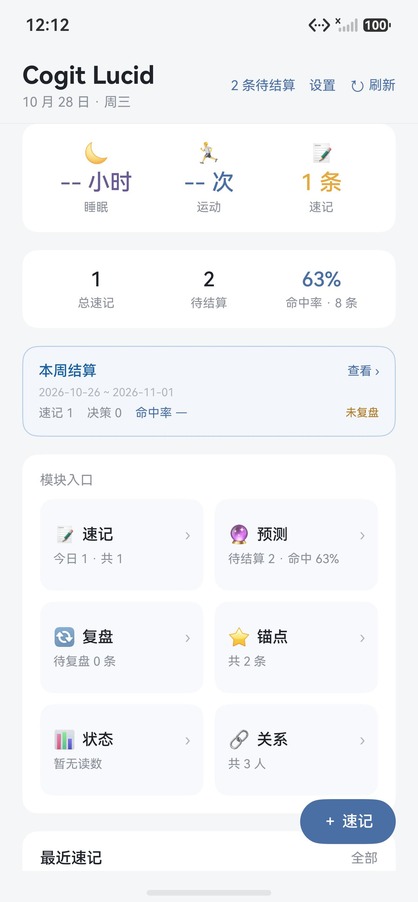
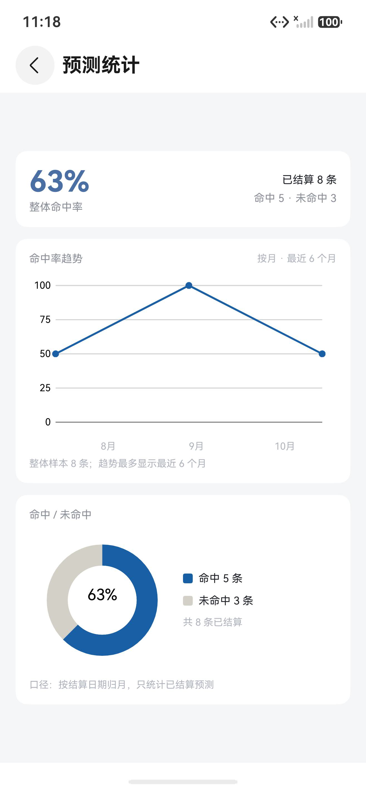
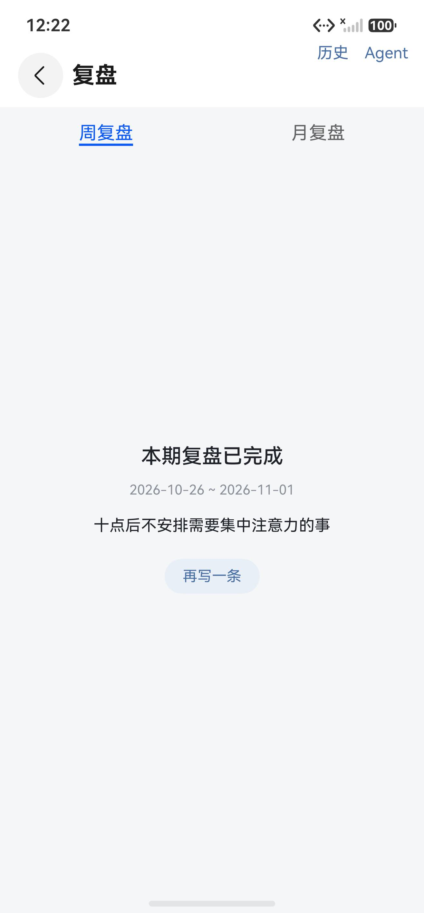
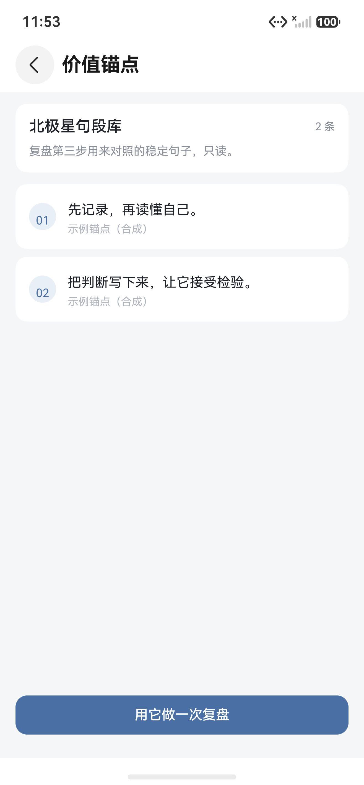
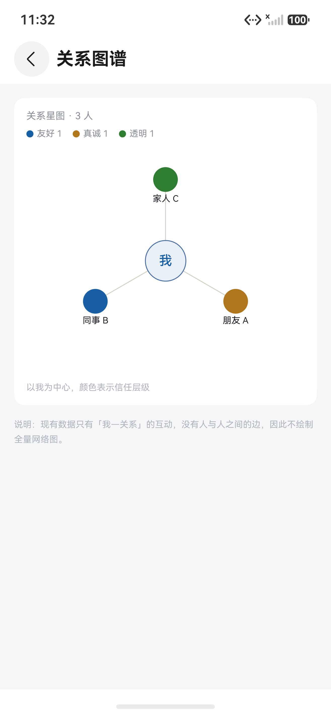
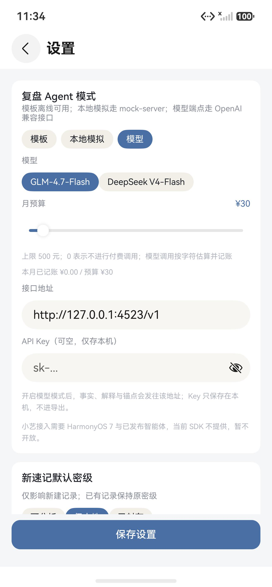
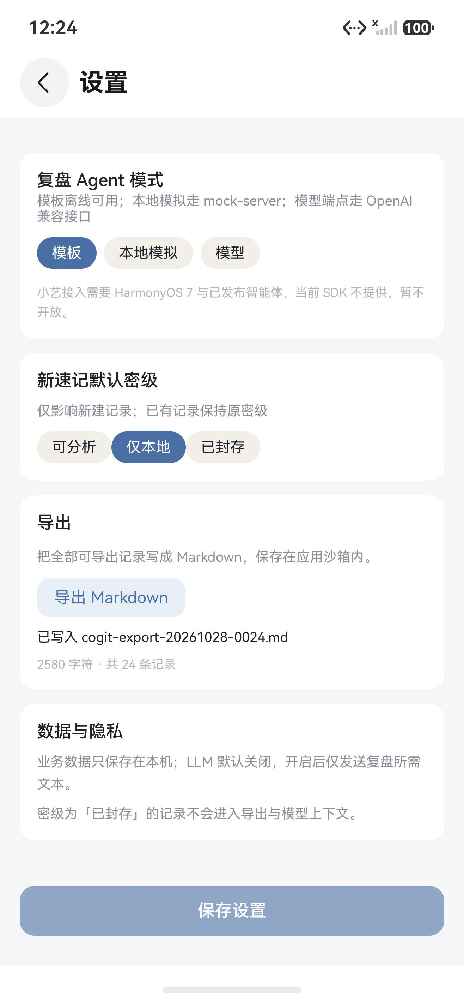

<h1 align="center">cogit-lucid-workbench</h1>

<p align="center">把「记录 → 复盘 → 校准 → 锚点对照」的元认知循环做成日常习惯的 HarmonyOS 本地应用。</p>

<p align="center">
  <a href="./README.md">English</a> | <a href="./README.zh-CN.md">简体中文</a>
</p>

<p align="center">
  <a href="./LICENSE"></a>
  
  
  
</p>

## 项目简介

cogit-lucid-workbench 是一个单模块 HarmonyOS 应用，设备上显示为 **Cogit Lucid**。它把注意到的事、做过的决定、下过的判断和事后的复盘留在本地，再把这些记录带进下一轮。适合已经在做复盘、并且希望自己的判断事后可以被检验的人。

和普通日记相比，有三处不同：

- **预测在保存时就固定。** 每条预测带置信度、理由和一个提前定好的结算日。到期后对着结果结算，原先的判断没法悄悄改成「命中」。后续修改以版本形式追加。
- **模型默认不参与。** 记录存在设备本地数据库里，只有手动切到模型档位时复盘 Agent 才会读取，API Key 也只留在本机。
- **锚点只读。** 一小批你决定留下的句子充当对照基准，复盘第三步用它检验自己的解释。

界面目前只有中文。应用显示名在 `entry/src/main/ets/theme/AppIdentity.ts`，桌面标签在 `AppScope/resources/base/element/string.json`。

## 项目状态

当前版本覆盖速记、预测与结算、复盘与 Agent、关系、锚点、状态、设置与导出，已具备本地使用流程。项目仍在持续完善。

## 核心功能

| 功能 | 作用 |
|---|---|
| 预测日志 | 目标、判断、0–100 置信度、理由、结算日一次写定；结算时补上结果并标记命中与否。 |
| 命中率统计 | 整体命中率、最近六个月的逐月趋势、命中与未命中的环图，用 `@ohos/mpchart` 绘制。 |
| 四步复盘 | 事实、解释、矛盾、行动；矛盾这一步最多引用三条锚点。 |
| 三层信任 | 每条关系带友好、真诚、透明之一的分层，以我为中心画成星图。 |
| 阈值读数 | 睡眠低于 6.5 小时、运动为零、凌晨报警一次，任一命中就在状态面板提示。 |
| Markdown 导出 | 七段记录渲染成一份 Markdown 文件，写在应用沙箱内。 |
| 页面背景 | 每个模块组可选一张本机图片，复制到应用沙箱，以低透明度图层显示。 |

## 架构

代码分成六层，依赖方向只有一条，最底下是共享类型层。每层只调用它下面的层；`analysis/` 只 import `model/` 的类型，规则因此不需要数据库和界面就能单独验证。`data/` 层负责首页聚合等跨实体读取。

```text
┌─────────────────────────────────────────────────────────────┐
│ interaction   pages/  views/  components/  navigation/      │
│               render and route dispatch                     │
├─────────────────────────────────────────────────────────────┤
│ domain        note/  prediction/  review/  anchor/          │
│               relation/  status/                            │
│               validation, composition, projection           │
├─────────────────────────────────────────────────────────────┤
│ data/         首页聚合、跨实体读取                           │
├─────────────────────────────────────────────────────────────┤
│ analysis/     contradiction  calibration  anchors/trust     │
│               status rules   llm adapter                    │
│               imports model/ only                           │
├─────────────────────────────────────────────────────────────┤
│ network/      prompt repository  OpenAI-compatible          │
│               local mock client  默认阻止明文                 │
├─────────────────────────────────────────────────────────────┤
│ records       db/  settings/  export/                       │
│               relationalStore, Preferences, Markdown        │
├─────────────────────────────────────────────────────────────┤
│ model/        seven entity types, enums, factories          │
│               no imports outside model/                     │
└─────────────────────────────────────────────────────────────┘
```

- 页面用 ArkTS 与状态管理 V2（`@ComponentV2`、`@Local`、`@Param`）；实体模型与服务用普通 TypeScript。
- 路由走 `NavPathStack`，20 个路由名集中在 `entry/src/main/ets/navigation/Routes.ts`，新增页面只往 `Index.pageMap` 加一个分支。
- `relationalStore` 是唯一事实源，`Preferences` 存非敏感设置，模型密钥存入系统资产库，`fileIo` 写 Markdown 导出。
- 运行时依赖只有 `@ohos/mpchart` 3.1.0-rc.0。图标用系统字形，没有引入图标包。

## 使用示例

首页是入口：当天读数、本周结算卡，以及六个模块的入口网格。设置放在右上角。



### 记一条预测

1. 进入预测模块（`预测`）。列表把待结算的按到期日排在前面，已结算的按创建时间排。
2. 点 `+`，填目标、判断、0 到 100 的置信度、理由和结算日。
3. 保存。从这一刻起记录只追加：之后再改会新增一个版本，不会覆盖原来那条。
4. 到期后打开详情页，填上结果，标记命中或未命中。
5. 进预测统计（`预测统计`）看整体命中率、趋势和命中占比。

预期结果：结算过两三条之后，统计页会画出趋势线和环图；一条都没结算时命中率显示破折号，旁边标明样本量。

### 做一次复盘

1. 进入复盘模块（`复盘`），选周复盘或月复盘。两个 Tab 各存各的草稿。
2. 按四步往下写：事实、解释、矛盾、行动。事实和行动是必填项。
3. 矛盾这一步可以勾选最多三条锚点，用它们检验自己的解释。
4. 需要的话打开 Agent 面板生成矛盾候选。模板档位离线可用，本地模拟与模型档位会请求端点。
5. 保存。该周期显示为已完成，这次复盘进历史。

### 把记录取出来

设置（`设置`）会把整份记录写成 `cogit-export-YYYYMMDD-HHMM.md`，放在应用沙箱内，并在页面上报出文件名、字符数和条数。已封存的记录不写进去。

## 运行截图

截图来自 Mate 70 Pro 模拟器，其中记录均为合成示例。

| 预测统计 | 复盘已完成 |
|---|---|
|  |  |
| **价值锚点** | **关系图谱** |
|  |  |
| **设置 · 模型档位** | **Markdown 导出结果** |
|  |  |

## 快速安装

### 环境

- 已安装 HarmonyOS SDK 的 DevEco Studio。工程 `targetSdkVersion` 为 26.0.0，兼容 6.1.1（API 24）。
- 一台 HarmonyOS 手机模拟器或手机。`deviceTypes` 只声明了 `phone`。
- 想跑本地 Mock 服务才需要 Node.js。

### 取代码

```bash
git clone git@github.com:SunshineMahiru/cogit-lucid-workbench.git
cd cogit-lucid-workbench
```

Gitee 镜像在 `git@gitee.com:theangelnextdoor/cogit-lucid-workbench.git`。

### 装依赖

用 DevEco Studio 打开工程，等 Sync 走完。运行时依赖只有 `@ohos/mpchart` 3.1.0-rc.0，声明在 `oh-package.json5`。

也可以在工程根目录用命令行构建：

```bash
node "<DevEco Studio>/tools/hvigor/bin/hvigorw.js" assembleHap --mode module -p product=default --no-daemon
```

执行前需要把 `DEVECO_SDK_HOME`、`NODE_HOME`、`JAVA_HOME` 指向 DevEco 工具链。跟踪的配置里没有签名信息；本地没有签名文件时，产物是未签名 HAP。

## 快速开始

1. 用 DevEco Studio 打开工程，等 Sync 完成。
2. 启动手机模拟器，或连一台手机。
3. 选中 `entry` 模块，点运行。
4. 在首页进入速记（`速记`），写一行，保存。
5. 这条记录出现在最近速记里，首页的计数随之变化。

预期结果：首页显示今日速记 1 条、共 1 条，本周结算卡开始把它算进去。

## 配置

### 本地 Mock 服务

复盘提示面板对接的是 `mock-server/` 里那个零依赖 Node 服务。

```bash
node mock-server/server.js
```

默认监听 `0.0.0.0:4523`，用 `PORT` 可以改端口。

| 方法 | 路径 | 返回 |
|---|---|---|
| GET | `/health` | `{ "status": "ok" }` |
| GET | `/review-prompts?period=week` | `{ "prompts": [...] }` |
| GET | `/review-prompts?period=month` | `{ "prompts": [...] }` |
| POST | `/llm/complete` | 本地模拟客户端用的补全结果 |
| POST | `/v1/chat/completions` | OpenAI 兼容的 `choices[0].message.content` |

### 让应用连上服务

- DevEco 预览器：`http://127.0.0.1:4523` 直接可用。
- 模拟器：`127.0.0.1` 指向模拟器自己。要么把 `entry/src/main/ets/network/ApiConfig.ts` 里的 `API_BASE_URL` 改成宿主机局域网地址，要么先执行 `hdc rport tcp:4523 tcp:4523` 做端口转发。
- 真机：localhost 不算有效地址。请在设置里把接口地址改为宿主机地址，否则显示本地回退提示。
- 明文 HTTP 默认关闭，`network_config.json` 只放行 `127.0.0.1` 与 `localhost`；真机要通过 HTTP 访问 Mock，需要在本机把宿主机地址加进这个文件，并且不要把该改动提交。客户端超时 5 秒。

### 复盘 Agent 三档

| 档位 | 请求目标 | 说明 |
|---|---|---|
| 模板 | 不请求 | 默认档，离线可用。 |
| 本地模拟 | `POST /llm/complete` | 不需要 Key。 |
| 模型 | OpenAI 兼容的 `/v1/chat/completions` | 需要接口地址、模型名和 API Key。Key 只存本机，不进导出。 |

月度预算给付费调用设上限。预算为 0 时不发起付费请求；费用按字符数估算并记进月度账本；预算用尽或请求失败会退回模板档。

### 密级

| 密级 | 新建记录默认 | 进入模型上下文 | 进入导出 |
|---|---|---|---|
| `analyzable` | 否 | 切到模型档后可以 | 是 |
| `local_only` | 是 | 否 | 是 |
| `sealed` | 否 | 否 | 否 |

密级在每条记录上单独选。设置页里的默认值只管此后新建的记录。

### 签名

跟踪的 `build-profile.json5` 故意保持 `signingConfigs` 为空。构建时，`hvigorfile.ts` 会在本地存在 `signing/signing.local.json` 时读取它，并注入 `default` 签名配置。本文件以及 `.p12`、`.cer`、`.p7b` 材料都被忽略，所以新克隆的仓库构建出来是未签名 HAP。

本地签名步骤：

1. 把 `docs/signing.local.example.json` 复制为 `signing/signing.local.json`。
2. 填入证书、profile、keystore 路径，以及 DevEco 生成的 `keyPassword` / `storePassword` 密文。文档里说明的是密文字段；除非本机 hvigor 版本确认接受明文，不要直接改成明文。
3. 重新构建，确认 `entry/build/default/outputs/default/` 下出现 `entry-default-signed.hap`。

### 导出

设置页把事件、决策、关系、预测、锚点、状态读数和复盘结果写成一份 Markdown。文件留在应用沙箱里，取出来需要手动操作。

## 目录结构

```text
cogit-lucid-workbench/
├── AppScope/                     bundle 名、版本、桌面图标
├── entry/                        唯一的模块
│   ├── src/main/
│       ├── ets/
│       │   ├── entryability/     应用入口
│       │   ├── pages/            20 个路由页、宿主页、占位页
│       │   ├── views/            首页组合视图
│       │   ├── components/       22 个可复用组件
│       │   ├── navigation/       路由名与参数类型
│       │   ├── model/            实体类型、枚举、工厂、示例数据
│       │   ├── data/             首页聚合、跨实体读取
│       │   ├── note/ prediction/ review/ anchor/ relation/ status/
│       │   ├── analysis/         规则、分析器、LLM 适配器
│       │   ├── db/               表结构、工具、七个 DAO
│       │   ├── settings/         Preferences 键、资产库密钥、LLM 预算账本
│       │   ├── export/           Markdown 分段与写文件
│       │   ├── network/          提示仓库、HTTP、LLM 客户端
│       │   └── theme/            设计令牌、应用标识
│       └── resources/            字符串、颜色、图标、网络配置
│   └── src/test/                 Hypium 单元测试
├── mock-server/                  零依赖 Node Mock 服务
├── signing/                      本地签名配置和材料（忽略）
├── docs/                         UI 冻结记录、调试截图、签名模板
├── build-profile.json5           SDK 版本、产物、构建模式
├── oh-package.json5              依赖声明
└── LICENSE                       AGPL-3.0
```

## 测试

`hvigorw test` 运行 `entry/src/test/List.test.ets` 中的 Hypium 用例，覆盖预测校验、置信度校准和 SEALED 导出过滤，共 4 条。

## 文档

| 主题 | 内容 | 链接 |
|---|---|---|
| 视觉令牌 | 锁定的颜色、字号、圆角、间距，以及逐页目视清单和已知差异 | [docs/UI_FREEZE.md](./docs/UI_FREEZE.md) |
| 本地签名模板 | 用于 `signing/signing.local.json` 的占位配置 | [docs/signing.local.example.json](./docs/signing.local.example.json) |
| Mock 服务 | 端点、寻址方式，以及预览器与模拟器的区别 | [mock-server/README.md](./mock-server/README.md) |

## 常见问题

**预览器里首页空白，或者报数据库错误。**
DevEco 预览器不提供 `relationalStore`，依赖数据的页面会走兜底。要看真实记录请用模拟器或手机。

**模拟器连不上 Mock 服务。**
模拟器里的 `127.0.0.1` 指向模拟器自己。把 `entry/src/main/ets/network/ApiConfig.ts` 的 `API_BASE_URL` 改成宿主机局域网地址，或者在启动前执行 `hdc rport tcp:4523 tcp:4523`。

**构建出来的 HAP 装不上。**
本地没有签名文件时，`assembleHap` 产出的是 `entry-default-unsigned.hap`。参照 `docs/signing.local.example.json` 建立 `signing/signing.local.json`，或在 DevEco Studio 里配置签名后重新构建。跟踪的 `build-profile.json5` 故意不含签名信息。

**桌面名字和应用内标题不一致。**
桌面标签 `cogit-lucid-workbench` 来自 `AppScope/resources/base/element/string.json`，应用内标题 `Cogit Lucid` 来自 `theme/AppIdentity.ts`。中文名还没定，两处都是占位。

**为什么只有一个依赖。**
图表用 `@ohos/mpchart` 画在原生 Canvas 上，没有用 Web 组件，也没有引入第三方图标包，包体小一些，也省掉素材授权问题。

**支持深色模式吗。**
暂时不支持。`theme/AppTheme.ts` 只有一套浅色令牌，只有启动页底色配了深色版本。

## 贡献指南

- 提交信息遵循 Conventional Commits：`type(scope): subject` 的 subject 用英文，正文说明原因。
- 一个提交只做一件事。大一些的功能分成若干步，每步都能单独验证。
- 代码注释统一用英文。
- 提 PR 之前跑一遍 `code-linter.json5` 里的规则集，并确认工程还能构建。
- 签名材料、安装包、报告不要进提交，`.gitignore` 已经覆盖。
- PR 里写清动机，以及你是怎么验证这次改动的。

## 许可证

本项目基于 [GNU Affero 通用公共许可证第三版](./LICENSE) 发布。

版权所有 (c) 2026 SunshineMahiru（曦昼Sunshine）。
